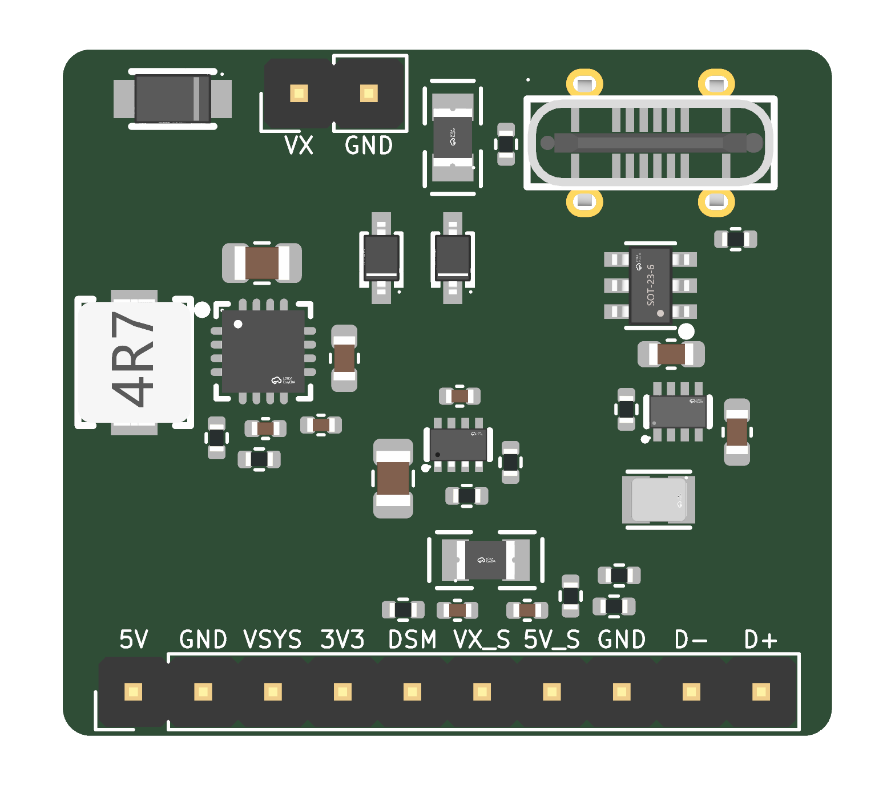

# Nexus-style FC power module

The power block of the [nexus-style-fc](../nexus-style-fc/) main board, on its own 26 × 22 mm 4-layer board. It has the same parts, values, LCSC codes and reference designators as the main board.

**Status: schematic done, PCB placed but not routed.** It passes ERC, DRC (0 errors) and schematic/PCB parity.

| Block | Parts |
|---|---|
| VX input TVS | D4 SMF13A |
| 5 V buck, 3 A | U5 TPS62130, L1 2.2 µH, C21–C24, R11/R12 (5.16 V) |
| 5 V priority mux | U9 TPS2116: buck first, USB VBUS second (switch-over at 4.7 V) |
| VSYS OR + 3V3 buck, 1 A | D5/D6 B5819WS, U14 TPS629210, L2 2.2 µH, R15, C27/C28 |
| DSM 3V3 port fuse | F2 0.5 A PTC |
| ADC sense dividers | R16–R19, C29/C30 (VX ×0.161, 5V ×0.323) |

| Header | Pins |
|---|---|
| J1 in (1×4, 2.54 mm) | VX, GND, VBUS, GND |
| J2 out (1×8, 2.54 mm) | 5V, GND, VSYS, 3V3, 3V3_DSM, GND, VX_SENSE, 5V_SENSE |

PCB: 1.6 mm, 4 layers (F.Cu parts and signals, In1 GND, In2 GND or power, B.Cu signals). All parts are on the top side. The design rules use JLCPCB's no-surcharge limits: 0.09 mm track and space, and a single 0.2 / 0.45 mm via. Net classes: HighCurrent is 0.5 mm (VX, SW_5V, 5V_BUCK, 5V) and Power is 0.3 mm (VBUS, VSYS, 3V3, SW_3V3, 3V3_DSM).

| Path | Contents |
|---|---|
| `hardware/` | KiCad project, plus `library/` with the NexusFC footprints, symbols and 3D models this board uses (copied from nexus-style-fc) |
| `tools/design_power.py` | Takes the POWER group from `../nexus-style-fc/tools/design.py` and adds the headers, block grouping and placement |
| `tools/gen_power_schematic.py` | Draws the schematic: wired blocks, power symbols for the rails, local labels on internal nodes, global labels only on the J2 signals. It exports the netlist and fails unless the connections match `design_power.py` exactly |
| `tools/build_power_module.py` | Builds the PCB: outline, stackup, rules, parts, and nets named as in the schematic |
| `tools/build.sh` | Regenerates the schematic and PCB, runs ERC and DRC, and exports `docs/` |
| `docs/` | Schematic PDF and top render |

Running `tools/build.sh` regenerates the PCB, which wipes any routing done in KiCad. After you start routing, change the board in KiCad or with "Update PCB from Schematic" instead.
