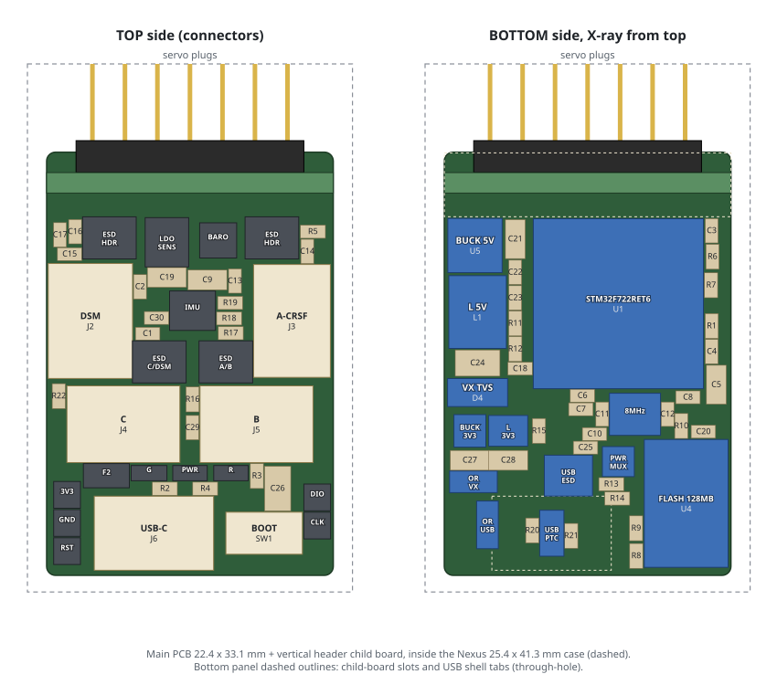

# Nexus-style FBL controller

This is a fresh KiCad 10 design modelled on the [RadioMaster Nexus](https://radiomasterrc.com/products/nexus-control-system) flybarless controller. It uses LCSC-purchasable parts and keeps the stock Rotorflight `RDMS-NEXUS_F7` pinout, as its resource-map basis. Stock-target orientation and hardware bring-up remain unverified.

**Status: unfinished F722-rule reroute. Do not fabricate or assemble from this checkpoint.**
The requested rule floor is now 0.127 mm track/clearance, with 0.15 mm preferred signal width,
0.254 mm minimum copper-to-edge (the main board retains its stricter 0.30 mm),
0.20 mm drill-to-copper, 0.25 mm drill-to-drill, and 0.125 mm via annulus.
Existing stronger header-board rules are retained. Main vias remain 0.45/0.20 mm.

The existing copper does not yet satisfy these rules. Native KiCad 10.0.7 confirms
636 main-board rule errors and 11 header contact-pad edge errors after refill, with
zero opens and zero schematic-parity issues at this initial rule-transfer checkpoint.
The main reroute is in progress. Header contact/slot geometry needs a separate
mechanical decision. See [the current checkpoint and open gates](docs/f722-reroute-status.md).
Existing manufacturing outputs are historical/stale and must not be used as current CAM.

| Path | Contents |
|---|---|
| `hardware/nexus-style-fc.kicad_pro` | Main board: full schematic + routed 6-layer PCB |
| `hardware/header-board/` | Servo-header child board, a separate KiCad project |
| `hardware/library/` | LCSC footprints, symbols and 3D models, plus the project footprints |
| `firmware/RDMS-NEXUS_F7.config` | Upstream Rotorflight target config, used for the pin map (see below) |
| `tools/` | `design.py` (single source of truth) + generators and routing; `build_all.sh` rebuilds everything and runs the checks |
| `manufacturing/` | Per board: JLCPCB Gerber zip, BOM and CPL; plus KiCad BOMs |
| `docs/` | Review notes and renders |

The firmware config is copied unchanged from [rotorflight-targets `configs/RDMS-NEXUS_F7.config`](https://github.com/rotorflight/rotorflight-targets/blob/master/configs/RDMS-NEXUS_F7.config) (master, latest commit `b89676f`, 2026-03-02) and stays attributed to its upstream authors. No firmware binary is included. RadioMaster branding is not used on the board.
