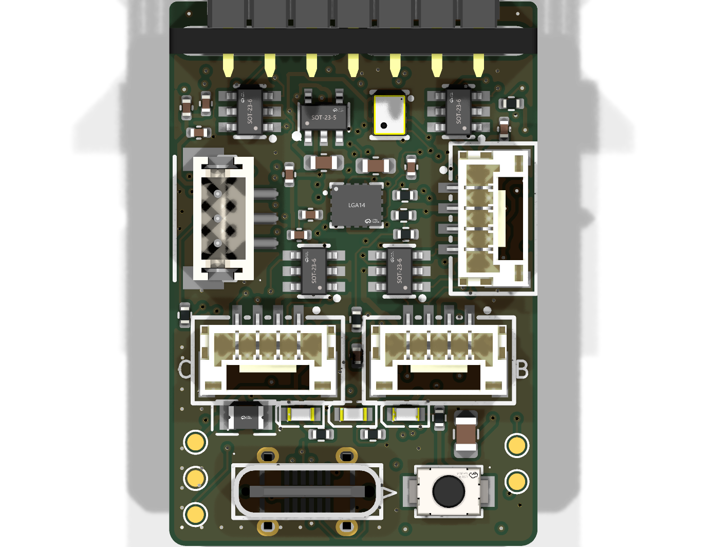
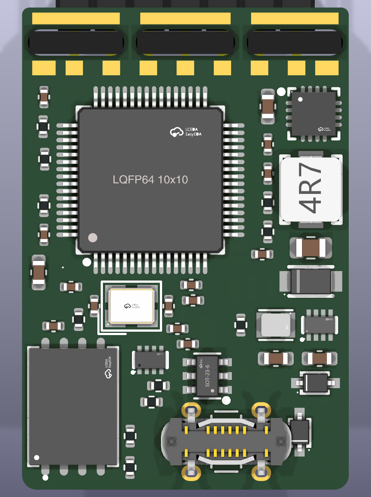
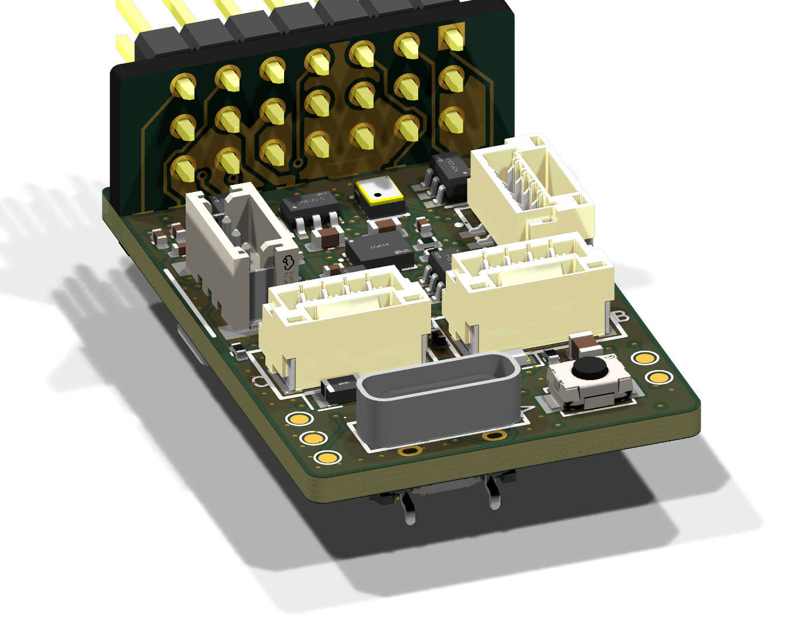
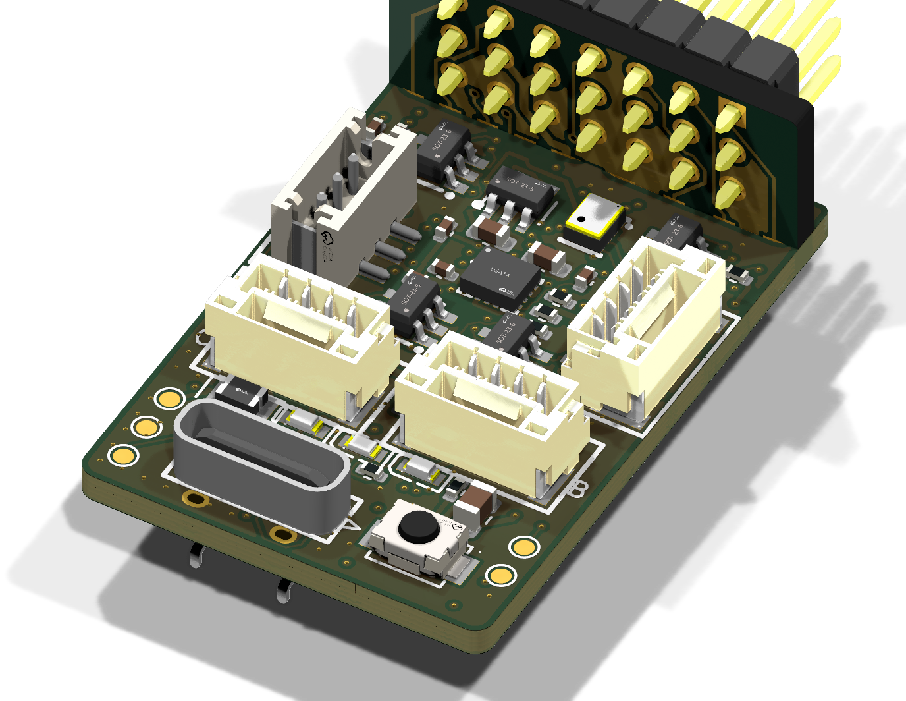
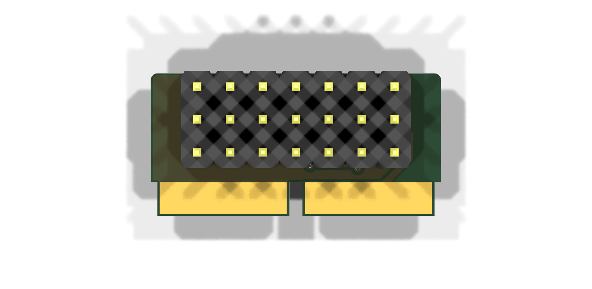
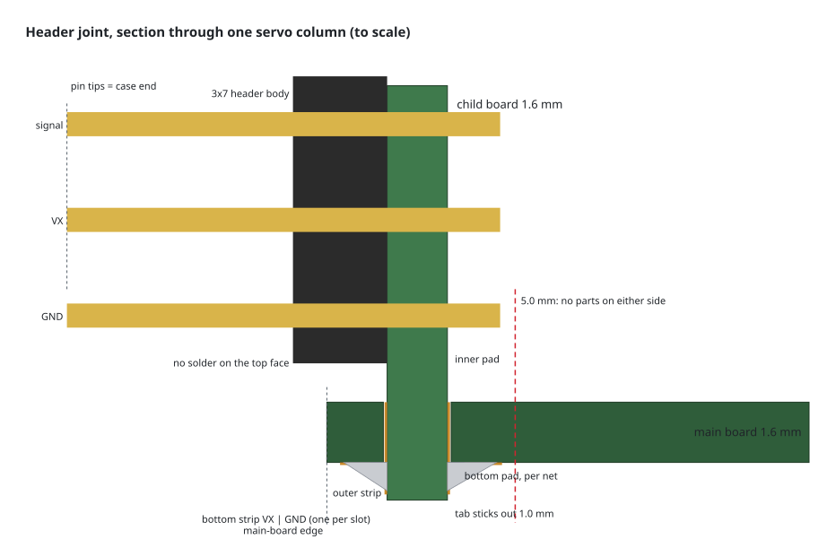
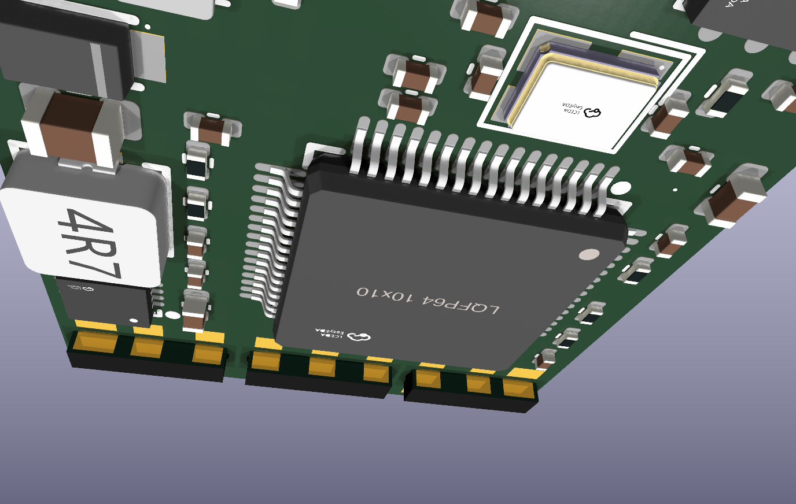
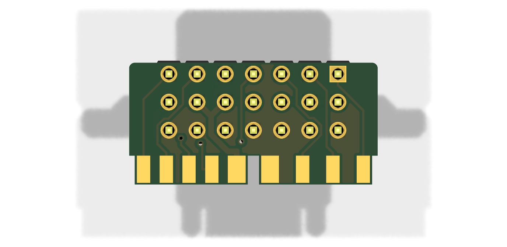

> This is the historical revision-5 design narrative. Its old rule, routing and manufacturing claims are superseded by [the F722 reroute status](f722-reroute-status.md). The current draft is unfinished and must not be ordered. The historical test table below does not certify current copper or the new rules.

# Design review — revision 5: routed 6-layer board, VBar-style 2-bar joint, JLCPCB outputs

**Historical revision-5 check, under the former rules:** KiCad 10.0.6:

| Board | ERC | DRC errors | Unconnected | Schematic ↔ PCB parity |
|---|---|---|---|---|
| Main board (6 layers) | 0 | 0 | 0 | 0 issues |
| Header child board (2 layers) | 0 | 0 | 0 | 0 issues |

The remaining DRC warnings are silkscreen artwork from the LCSC footprints (overlaps, text over pads; the Gerbers clip silk away from exposed copper), plus 12 short track ends that KiCad calls "dangling" but that carry a connection along their length.

- Schematics: [main](schematic-main.pdf), [header child board](schematic-header-board.pdf)
- JLCPCB packages: [manufacturing/](../manufacturing/) (see [Manufacturing files](#manufacturing-files))

| Top | Bottom (seen from below) |
|---|---|
|  |  |

| Servo end | USB end |
|---|---|
|  |  |

## Changes since revision 4

1. **Header joint redone VBar style: two bars, soldered on the bottom only.** The child board ends in two long tabs (bar–gap–bar, 1.0 mm gap) that pass through two long non-plated slots and stick out 1.0 mm below the main board. All soldering is on the main board's **bottom** face:
   - **Inner slot edge:** one pad per net. Left bar: SBUS, RPM, ESC, TAIL, VX. Right bar: GND, S3, S2, S1. VX and GND sit next to the centre bridge.
   - **Outer slot edge:** one long strip per slot, **VX** on the left and **GND** on the right, soldered to matching strips on the tab's outer (header) face.
   - No copper or solder on the main board's top face at the joint, and still no parts within 5.0 mm of the header edge on either side.
   - On the main board, the VX strip reaches the VX pad through the centre bridge on In2/In3, and the GND strip and pad drop straight into the In1/In4 ground planes. The copper next to the slots is laid by script with a 0.3 mm keep-out, so the router never goes near a slot.

   

   Section through one servo column, to scale:

   

   
   
2. **Main board is now 6 layers and fully routed** (see [Routing](#routing)).
3. **SWD test pads moved to the right side**, next to the MCU's PA13/PA14; 3V3, GND and NRST pads are on the left.

## Routing

**Stackup** (JLCPCB 6-layer, 1.6 mm, JLC06161H-2116 style, ENIG): SIG – GND – SIG – SIG – GND – SIG.

| Layer | Use |
|---|---|
| F.Cu (1 oz) | parts, signals, GND pour |
| In1.Cu (0.5 oz) | solid GND plane |
| In2.Cu / In3.Cu (0.5 oz) | signals and power, GND pour |
| In4.Cu (0.5 oz) | solid GND plane |
| B.Cu (1 oz) | MCU, flash, power stages, signals, GND pour |

Every signal layer sits next to a ground plane. The inner layers are separated by the thick cores, so In2/In3 signals reference In1/In4.

**Rules — JLCPCB 6-layer at no extra cost:**
- Track and spacing 0.09 mm minimum (3.5 mil). Signals are 0.12 mm and neck to 0.09 mm only at fine-pitch pads; spacing is 0.09 mm (0.12 mm next to VX / 5 V buck copper).
- **One via size everywhere: 0.2 mm drill / 0.45 mm pad**, the smallest JLCPCB builds without a surcharge: 227 vias. The revision assumed filled/capped via-in-pad, but current source uses ordinary tenting; that assembly-process assumption is unresolved.
- Copper 0.3 mm from the board edge and from the joint slots; 0.2 mm from any hole.
- Net widths: VX / 5 V buck / switch nodes 0.5 mm, USB 5 V 0.35 mm, 3V3 / VSYS / VBUS / DSM 3.3 V 0.25 mm, USB D+/D− 0.15 mm, signals 0.12 mm.

**How it was routed** (`tools/route_board.py`, rerun with `FREEROUTING_JAR` set):
1. Fixed copper at the header joint, GND planes on In1/In4.
2. Freerouting 2.5.0, several sessions in a row, keeping the best.
3. `tools/finish_route.py` connects what Freerouting left: a grid maze router that may rip up other nets' tracks, kept only if every cut net reconnects; it tries several net orders in parallel.
4. GND pours on the four signal layers, ground stitching vias, and a final check that every pour fragment reaches the planes.
5. `tools/clean_dangling.py` removes stubs left by rip-ups, only when connectivity is unchanged.

## Manufacturing files

Generated by `python3 tools/export_fab.py` into `manufacturing/<board>/`, set up for JLCPCB:

| File | Contents |
|---|---|
| `<board>-gerbers.zip` | Gerber RS-274X (Protel names) for every copper, mask, paste and silk layer, plus Excellon drill (plated and non-plated separate, slots as routed holes). Historical output; do not upload for an order until regenerated and released. |
| `<board>-bom-jlc.csv` | Comment, Designator, Footprint, LCSC Part # |
| `<board>-cpl-jlc.csv` | Designator, Mid X, Mid Y, Layer, Rotation |

The Gerbers, drills and CPL all use the board's lower-left corner as the origin.

**Order notes:**
- **Main board:** 6 layers, 1.6 mm, ENIG, JLC06161H-2116 stackup, minimum via 0.2/0.45 mm (the no-extra-cost option). 82 parts are placed on both sides; test pads TP1–TP5 and the joint have no part.
- **Check rotations in JLC's placement preview before paying**, especially bottom-side parts (U1, U4, U5, U9, U14, diodes, LEDs): JLC's rotation convention for bottom parts sometimes differs.
- **Child board:** 2 layers, 1.6 mm. The only part is the 3×7 through-hole header (C32713294); hand-soldering it is cheaper than JLC through-hole assembly. 2 oz copper is recommended, since servo current flows on it.
- Assembly: fit the child board through the slots so the tabs stick out 1.0 mm below the main board, then solder the per-net pads and the two long strips on the bottom.

## Circuit summary (values in the schematic)

| Block | Design |
|---|---|
| MCU STM32F722RET6 | - 100 nF on each of the 4 VDD pins, plus 4.7 µF bulk.<br>- VDDA: 1 µF + 100 nF. VBAT: 100 nF.<br>- **VCAP_1: single 4.7 µF**. The LQFP64 package has one VCAP pin, per the ST datasheet.<br>- NRST: 100 nF. BOOT0: 10 k pull-down, and the BOOT button goes to 3V3.<br>- 8 MHz crystal (CL 20 pF) with 2 × 30 pF. |
| IMU ICM-42688-P, SPI1 | - VDD: 100 nF + 2.2 µF. VDDIO: 10 nF.<br>- Reserved pins to GND, per TDK (pin 7 must be GND).<br>- 10 k pull-up on CS, so the IMU stays in SPI mode at boot. |
| Baro DPS368, I2C1 | - CSB to VDDIO selects I²C. SDO to GND gives **address 0x76, Rotorflight's DPS310 default**.<br>- 2 × 100 nF, 2.2 k pull-ups. |
| Flash W25N01GV, SPI2 | - 100 nF.<br>- 10 k pull-ups on CS, /WP and /HOLD.<br>- Exposed pad left floating, with no vias into the MCU underneath. |
| VX input | SMF13A TVS. |
| 5 V buck TPS62130 | - FSW = GND (2.5 MHz), DEF = GND.<br>- 2.2 µH (Chilisin 3 A), 10 µF 25 V in, 100 nF AVIN, 3.3 nF soft-start, 22 µF out.<br>- 120 k/22 k feedback: **5.16 V**. |
| 5 V bus mux TPS2116 | - Priority mode: buck on VIN1, USB on VIN2.<br>- PR1 divider 100 k/27 k switches over at **4.7 V**.<br>- 22 µF on the bus, 1 µF on VIN2. |
| MCU 3V3 buck TPS629210 | - Fed from VSYS, which is VX or USB through B5819WS diodes. Also supplies the DSM port.<br>- **27.4 k on S-CONF selects internal-divider mode; FB/VSET left open gives 3.3 V** (datasheet Tables 8-1 and 8-2).<br>- 2.2 µH, 4.7 µF 25 V in, 22 µF out. |
| Sensor 3V3 LDO TPS70933 | From VSYS. 1 µF in, 2.2 µF out (needs at least 2 µF effective). |
| DSM 3.3 V | From the MCU 3V3 rail through a 0.5 A polyfuse (F2). |
| Voltage sense | - VX: 52.3 k/10 k (×0.161) to PC1.<br>- 5 V bus: 21 k/10 k (×0.323) to PC2.<br>- 100 nF on each. These match `vbec_divider 160` and `vbus_divider 320`. |
| USB-C | - 5.1 k Rd on CC1/CC2.<br>- 0.5 A polyfuse, USBLC6-2SC6 ESD, 1 µF on VBUS. |
| Receiver ports | - GH-4: [GND, 5V, RX, TX]. ZH-3 DSM: [3.3V, GND, DATA].<br>- SRV05-4 ESD on all UART lines, referenced to 5 V.<br>- UART1 TX joins DSM DATA through 1 k for SRXL2 half-duplex. RX-only DSM is unaffected. |
| Servo header lines | SRV05-4 clamps right at the joint, referenced to 5 V, so lines clamp at about 5.7 V; all seven pins are 5 V-tolerant. No series resistors, per Rotorflight. |
| LEDs | - PC14 (yellow-green) and PC15 (red) are active-low through 1 k, about 1.3 mA. That is under the 3 mA these backup-domain pins can sink.<br>- Blue power LED on the 5 V bus, 1 k. |
| SWD | Test pads: SWDIO and SWCLK on the right edge, NRST, 3V3 and GND on the left edge. |

## How the design is generated

`tools/design.py` holds every part, value, LCSC number, net and placement for the main board; `tools/design_header.py` does the same for the child board. One command regenerates the footprints, both schematics, both PCBs, the drawing, PDFs and BOMs, then runs ERC, DRC and parity:

```bash
tools/build_all.sh
```

The schematics are generated: every pin has a wire stub and a net label, grouped by function. You can edit them in KiCad from now on, or keep editing `design.py` and regenerating. Pick one, because regenerating overwrites manual schematic edits.

## Open points

1. **IMU orientation:** U2's rotation will be set so the stock `CW90` alignment is correct, once we confirm which end of the Nexus faces forward.
