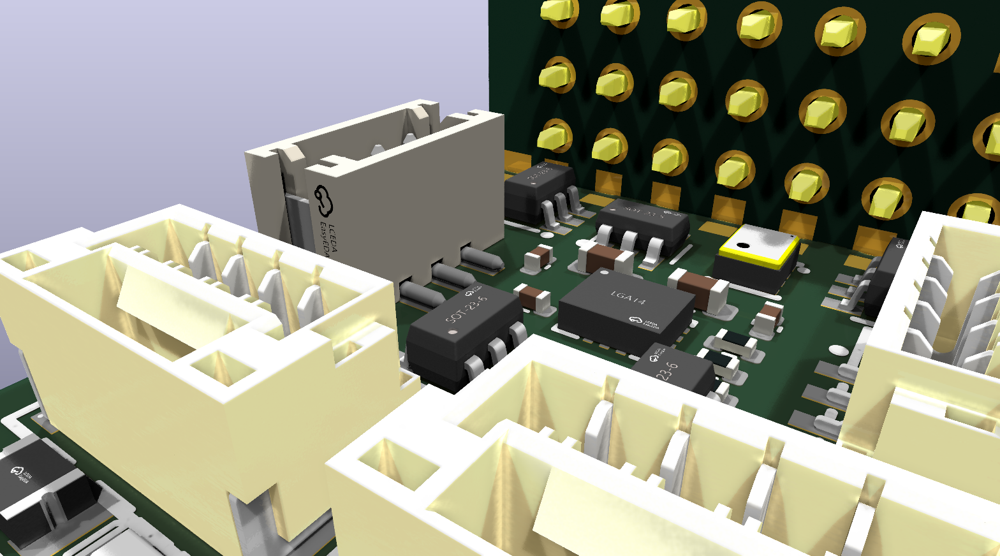
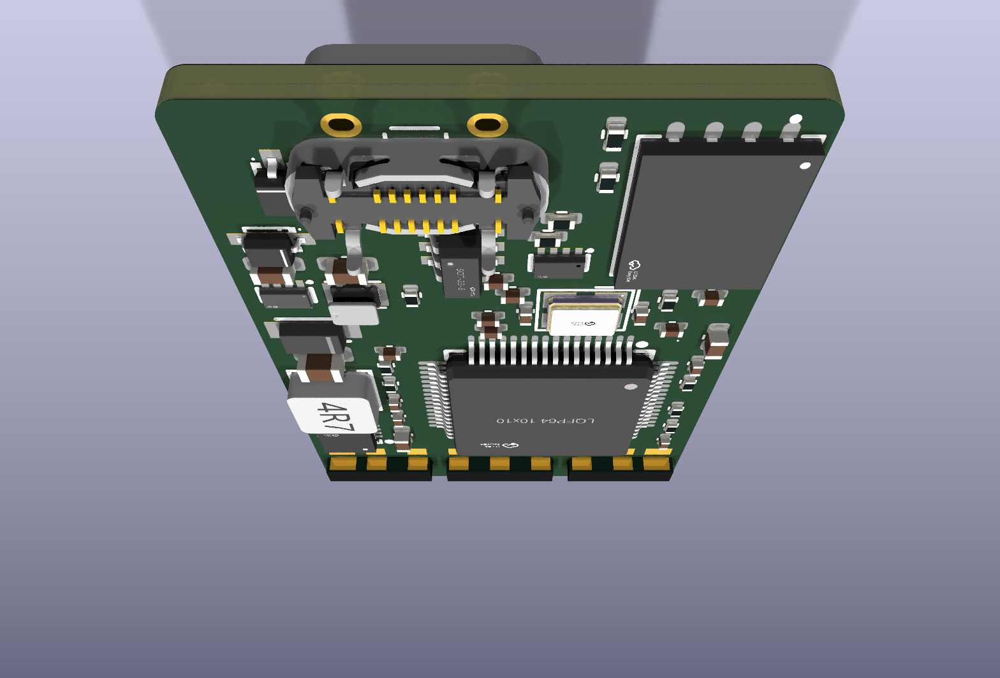

# Design review — revision 4: full schematic, 3-slot header joint, clear header band

**Status: schematic complete, every part placed, not routed.** Both boards pass KiCad 10.0.6 checks:

| Board | ERC | DRC errors | Schematic ↔ PCB parity | Unrouted connections |
|---|---|---|---|---|
| Main board | 0 | 0 | 0 issues | 275 (routing is the next step) |
| Header child board | 0 | 0 | 0 issues | 24 |

The only DRC warnings are silkscreen overlaps from LCSC footprint artwork. Silkscreen is redone at routing.

- Schematics: [main](schematic-main.pdf), [header child board](schematic-header-board.pdf)
- BOMs with LCSC part numbers: [main](../manufacturing/bom-main.csv) (88 parts), [child board](../manufacturing/bom-header-board.csv)


| Top | Bottom (seen from below) |
|---|---|
|  |  |

| Servo end | USB end |
|---|---|
|  |  |

## Changes since revision 3

1. **Header joint is now bar–gap–bar–gap–bar.** The child board has three long tabs with 1.0 mm gaps between them, going into three long **non-plated** slots:
   - Tab 1: VX, SBUS, RPM.
   - Tab 2: ESC, TAIL, S3.
   - Tab 3: S2, S1, GND.

   **Both sides of the child board are soldered.**
   - **Inner face:** one pad per net (7 signals, plus VX and GND). Each is soldered to the inner slot edge on the main board's top and bottom.
   - **Outer face (header side):** one long full-width strip per tab, **GND – VX – GND**: a big power strip in the middle, ground on each side. They are soldered to matching strips on the outer slot edges, on both the main board's **top and bottom**.
     - On top, the outer strips sit under the header's plastic body, with a 0.7 mm gap that is open at the board edge.
     - Solder them with paste and hot air, or with a fine iron tip from the board edge.
     - The bottom joints can be done with an ordinary iron.

   Every tab is therefore soldered on both faces, top and bottom: four fillets per column. Power and ground get the wide strips, and every signal gets its own pad.

   To make room for the outer strips, the child board moved 0.8 mm inward, so the main board now runs 1.6 mm past its outer face, under the header body. The servo pin tips are still flush with the case end, and the main board grew to **22.4 × 33.1 mm**. The gaps between tabs fall between pads, so none is cut.

   

   Section through one servo column, to scale:

   

   From the socket (top) side: the child board's inner face, its pin tails, and the per-net pads at its foot on the main board's top pads.

   
   
   
2. **No parts within 5.0 mm of the header edge, top or bottom.** The joint footprint's courtyard covers that band on both layers, so KiCad's DRC flags any part placed in it.
3. **To make room, DSM 3.3 V now comes from the MCU 3V3 buck through a 0.5 A polyfuse (F2).** This is the option Rotorflight's requirements allow. The TPS629210 is rated 1 A: MCU, sensors and flash draw about 0.2 A, plus up to 0.5 A for DSM. The separate DSM buck and its five support parts are removed.
4. **Hand-placed clusters:**
   - The 5 V buck runs along the VX side.
   - The MCU 3V3 buck sits at the lower left.
   - The crystal sits right below the oscillator pins, with its load capacitors on each side.
   - The USB fuse sits between the USB shell tabs, with the ESD and mux next to it.
   - The MCU moved 0.7 mm right.
   - The two MCU VDD capacitors and VCAP that sit under the 5 V buck strip are on the top side, directly over their pins.
   - The voltage-sense dividers are on the top side as well.
5. **The MCU buck output is a single 22 µF**, TI's typical value, replacing 2 × 10 µF.

Four small parts are on the opposite side from their pin and connect through a via: the I²C pull-ups, the sensor-LDO input capacitor and the 5 V bulk capacitor. None of them is timing- or stability-critical.

## Circuit summary (values in the schematic)

| Block | Design |
|---|---|
| MCU STM32F722RET6 | - 100 nF on each of the 4 VDD pins, plus 4.7 µF bulk.<br>- VDDA: 1 µF + 100 nF. VBAT: 100 nF.<br>- **VCAP_1: single 4.7 µF**. The LQFP64 package has one VCAP pin, per the ST datasheet.<br>- NRST: 100 nF. BOOT0: 10 k pull-down, and the BOOT button goes to 3V3.<br>- 8 MHz crystal (CL 20 pF) with 2 × 30 pF. |
| IMU ICM-42688-P, SPI1 | - VDD: 100 nF + 2.2 µF. VDDIO: 10 nF.<br>- Reserved pins to GND, per TDK (pin 7 must be GND).<br>- 10 k pull-up on CS, so the IMU stays in SPI mode at boot. |
| Baro DPS368, I2C1 | - CSB to VDDIO selects I²C. SDO to GND gives **address 0x76, Rotorflight's DPS310 default**.<br>- 2 × 100 nF, 2.2 k pull-ups. |
| Flash W25N01GV, SPI2 | - 100 nF.<br>- 10 k pull-ups on CS, /WP and /HOLD.<br>- Exposed pad left floating, with no vias into the MCU underneath. |
| VX input | SMF13A TVS. |
| 5 V buck TPS62130 | - FSW = GND (2.5 MHz), DEF = GND.<br>- 2.2 µH (Chilisin 3 A), 10 µF 25 V in, 100 nF AVIN, 3.3 nF soft-start, 22 µF out.<br>- 120 k/22 k feedback: **5.16 V**. |
| 5 V bus mux TPS2116 | - Priority mode: buck on VIN1, USB on VIN2.<br>- PR1 divider 100 k/27 k switches over at **4.7 V**.<br>- 22 µF on the bus, 1 µF on VIN2. |
| MCU 3V3 buck TPS629210 | - Fed from VSYS, which is VX or USB through B5819WS diodes. Also supplies the DSM port.<br>- **27.4 k on S-CONF selects internal-divider mode; FB/VSET left open gives 3.3 V** (datasheet Tables 8-1 and 8-2).<br>- 2.2 µH, 4.7 µF 25 V in, 22 µF out. |
| Sensor 3V3 LDO TPS70933 | From VSYS. 1 µF in, 2.2 µF out (needs at least 2 µF effective). |
| DSM 3.3 V | From the MCU 3V3 rail through a 0.5 A polyfuse (F2). |
| Voltage sense | - VX: 52.3 k/10 k (×0.161) to PC1.<br>- 5 V bus: 21 k/10 k (×0.323) to PC2.<br>- 100 nF on each. These match `vbec_divider 160` and `vbus_divider 320`. |
| USB-C | - 5.1 k Rd on CC1/CC2.<br>- 0.5 A polyfuse, USBLC6-2SC6 ESD, 1 µF on VBUS. |
| Receiver ports | - GH-4: [GND, 5V, RX, TX]. ZH-3 DSM: [3.3V, GND, DATA].<br>- SRV05-4 ESD on all UART lines, referenced to 5 V.<br>- UART1 TX joins DSM DATA through 1 k for SRXL2 half-duplex. RX-only DSM is unaffected. |
| Servo header lines | SRV05-4 clamps right at the joint, referenced to 5 V, so lines clamp at about 5.7 V; all seven pins are 5 V-tolerant. No series resistors, per Rotorflight. |
| LEDs | - PC14 (yellow-green) and PC15 (red) are active-low through 1 k, about 1.3 mA. That is under the 3 mA these backup-domain pins can sink.<br>- Blue power LED on the 5 V bus, 1 k. |
| SWD | Test pads for SWDIO, SWCLK, NRST, 3V3 and GND. |

## How the design is generated

`tools/design.py` holds every part, value, LCSC number, net and placement for the main board; `tools/design_header.py` does the same for the child board. One command regenerates the footprints, both schematics, both PCBs, the drawing, PDFs and BOMs, then runs ERC, DRC and parity:

```bash
tools/build_all.sh
```

The schematics are generated: every pin has a wire stub and a net label, grouped by function. You can edit them in KiCad from now on, or keep editing `design.py` and regenerating. Pick one, because regenerating overwrites manual schematic edits.

## Next step: routing

The remaining step is routing: 4 layers, with GND on an inner layer, and power pours for VX, 5 V and 3V3. After that come silkscreen cleanup and JLCPCB fab/assembly outputs (Gerbers, CPL, BOM).

Open points:
1. **IMU orientation:** I'll fix U2's rotation so the stock `CW90` is correct, once we confirm which end of the Nexus faces forward.
2. **Child board copper:** 2 oz is recommended, since servo current flows on it.
