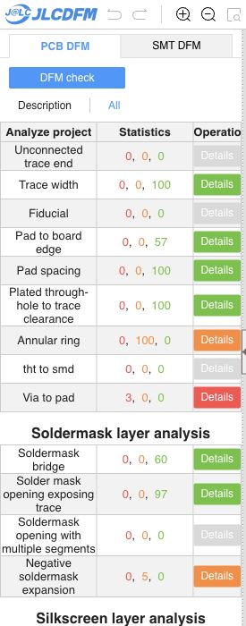

# C8 ground via and LED route review

**The owner's change passes native copper/connectivity checks and removes the last two mask-to-trace warnings. Keep it with an epoxy-filled and copper-capped via-in-pad process (POFV).** An ordinary unfilled via in this solder pad is not the assembly process recommended by this review.

The [fresh JLCDFM result](https://jlcdfm.com/viewer?pcbUploadFileId=634307466864316417) reports mask opening exposing trace **0 danger / 0 warning / 97 Good**, previously 0 / 2 / 95. Pad spacing, trace spacing, trace width and sharp corners retain zero danger and zero warnings. Soldermask bridges remain green. Five previously investigated negative-mask recognition flags remain. The website caps results per layer; these counters are fabrication screening.

## Exact change

One GND through-via is added at native **X 118.56 / Y 119.18 mm**, exactly at **C8 pad 2 (GND)**. Via diameter is **0.45 mm**, drill **0.20 mm**, and annulus **0.125 mm**. The pad is 0.56 x 0.62 mm. All previous 227 vias are unchanged; the new count is 228. The via directly connects this decoupling ground pad into the ground-plane network.

Two obsolete B.Cu GND segments are removed, freeing the corridor for LED2_K. Five former LED segments are replaced by two 0.14 mm B.Cu segments around C8. LED2_K straight-segment length decreases from **18.3263 to 17.3993 mm**. Its net and endpoints remain connected. Footprints, all 16 track arcs, setup, zone/keepout definitions, project, rules, schematic and BOM/CPL are unchanged. The review does not modify the owner's PCB. [Source diff](source-diff.json) and [via geometry](via-native.json) record the complete edit.

Native KiCad 10.0.6 reports **zero copper violations and zero unconnected items**, with the same ten inherited schematic-parity warnings. A separate refill on a temporary copy produces exactly the same semantic board and zone geometry, and passes the same checks. [Saved-board DRC](drc.json), [refilled DRC](refilled-drc.json), and [verification](verification.json) preserve both results.

## Via-in-pad process requirement

C8's bottom solder-mask and solder-paste openings include this via hole. The ordinary via tenting setting does not remove the overlapping pad opening. With a hollow hole, solder can flow into it during reflow and reduce solder available to the capacitor termination. Specify **epoxy filling followed by copper capping / POFV for this 0.20 mm via**, and verify it in the supplier's production files. This is a fabrication-order requirement; the Gerbers and a green DFM category do not establish that the factory has selected it.

[JLCPCB's current via-covering guide](https://jlcpcb.com/help/article/pcb-via-covering) distinguishes resin/copper filling from ordinary mask tenting and excludes pad holes from ordinary ink-plugging treatment. Its [POFV process guide](https://jlcpcb.com/news/free-via-in-pad-6-20-layer-pcbs-pofv) explains plated-over filling for solderable pad surfaces and lists 0.20 mm as a supported via-hole size. No current quotation, order selection, price or production approval was made here.

JLCDFM still reports zero in its separate “Via placed within a pad” category even though the native geometry conclusively contains the new C8 via-in-pad. That category is not proof that the assembly-process condition can be skipped.

## Matching outputs and remaining gates

The exact screened 16-member Gerber/drill/job ZIP and loose CAM files now match the saved owner PCB in manufacturing. The 51-group / 83-part BOM and 83-placement CPL are byte-identical to the preceding revision. SMT was not rerun. The child is unchanged. [Input binding](input-binding.json), [category comparison](dfm-comparison.json), [top mask details](exposure-top.txt), and [bottom mask details](exposure-bottom.txt) bind the evidence.

- Main PCB SHA-256: `e4e74a4350c5ddabd23d24b2ee663449adf000d929abc57a306ef78638f4745a`
- Gerber ZIP SHA-256: `62d82f6a7d48eecc96d83f35cc74b12f5d4dcd434f847e9eb7469c48579cde4c`

**Release remains HOLD** for the via-in-pad production-process confirmation and the inherited fabrication, assembly/model and engineering qualification gates. Other PCB findings include three via-to-pad and four slot-width danger flags, silkscreen findings and annular-ring warnings. Earlier reports keep their original bindings.
