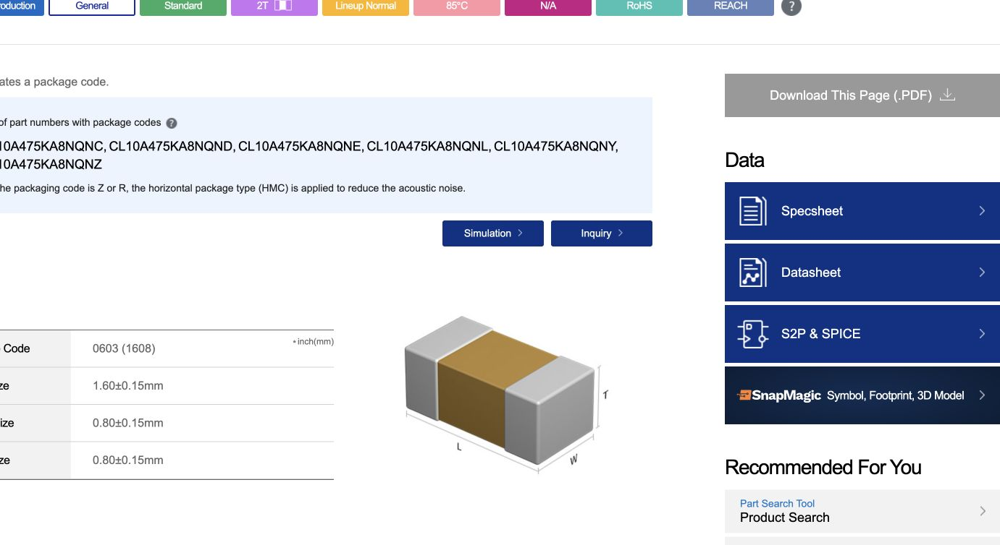

# C9 VCAP verification — 17 October 2026

**Disposition: capacitance identity and PCB connection verified; C9's ESR suitability is not cleared for the assembled order.** The manufacturer's typical ESR curve supplies evidence of much lower ESR than the MCU's specified range at representative frequencies. This does not establish an observed regulator failure, and the MCU table does not state a reference measurement frequency, so the graph is not a complete production compliance test.

## Exact board and connection

PCB SHA-256: `9b65ab90e9dfeecf8a440e4f1b522658419ee2d56a4e27513e03e35bf77e16ac`.

Read-only native KiCad inspection confirms:

- U1 is STM32F722RET6, LQFP64; pin 30 is VCAP1.
- C9 pad 1 connects directly to U1 pin 30 on B.Cu through one **1.684117 mm, 0.20 mm wide track**, with no vias on VCAP.
- C9 pad 2 is GND. Only C9 pad 1 and U1 pin 30 are assigned to VCAP; there is no other board load or series resistor on this net.
- The exact native source matches the fresh final-order native DRC with zero unconnected items.
- BOM C9 is **C69335 / Samsung CL10A475KA8NQNC**, grouped with C5. Do not change both parts unintentionally when resolving C9.

[Native assertions](native-check.json) bind this inspection to the saved PCB. Its data and all manufacturing files are unchanged.

## Primary-source comparison

[ST DS11853 Rev9, Table19, page105](https://www.st.com/resource/en/datasheet/stm32f722ie.pdf) specifies a single **4.7 µF** VCAP1 capacitor with **0.1–0.2 Ω ESR** for LQFP64. [ST AN4661, section1.2/page11](https://www.st.com/resource/en/application_note/an4661-getting-started-with-stm32f7-series-mcu-hardware-development-stmicroelectronics.pdf) repeats the STM32F7x2Rx requirement. It is package-specific; the two-capacitor / <2 Ω condition for other packages is not the relevant acceptance rule. Neither cited passage specifies an ESR measurement frequency.

[Samsung's exact product page](https://product.samsungsem.com/mlcc/CL10A475KA8NQN.do) and [manufacturer component datasheet](https://weblib.samsungsem.com/mlcc/mlcc-ec-data-sheet.do?partNumber=CL10A475KA8NQN) confirm **4.7 µF ±10%, 25 V, X5R, 0603** and that suffix C is a packaging option for this electrical family. Nominal capacitance and voltage identity are therefore correct.

The rendered frequency graph distinguishes **red |Z|** from **blue ESR**. A visual estimate of the blue curve at **0.1 MHz = 100 kHz** is about **0.01–0.02 Ω**, approximately **0.015 Ω**; at **1 MHz** it is around **0.004 Ω**. These are approximate readings of a logarithmic typical curve, not extracted numerical model values, tolerance limits, or measurements of purchased parts. In particular, the red impedance curve must not be substituted for ESR. Samsung explicitly describes its plotted data as typical design-reference data.

The typical ESR is thus substantially below 0.1 Ω at the illustrated frequencies. It cannot support approving the unmodified part against ST's stated 0.1–0.2 Ω requirement. Missing test-frequency/acceptance information also prevents claiming a complete formal pass/fail determination from this one graph. No DC-bias/temperature stability or regulator loop measurement was performed.

## Next engineering step

Resolve C9 with a documented compatible capacitor or a deliberately designed series-resistance network, establishing the relevant frequency/temperature/bias acceptance and validating VCAP stability/startup. A resistance value derived from one point on a typical ESR curve is only a candidate, not an automatic signoff. Any implementation should be confined to C9's branch; C5 serves a different rail. A BOM split, if needed, must be reflected in the schematic/source and fresh assembly exports. No such circuit change was made by this verification.

Evidence: [saved manufacturer page text](samsung-datasheet.txt), [native check](native-check.json), live primary-source links above. Only this review/evidence directory was created; PCB, schematic, project, Gerbers and BOM/CPL remain unchanged.
