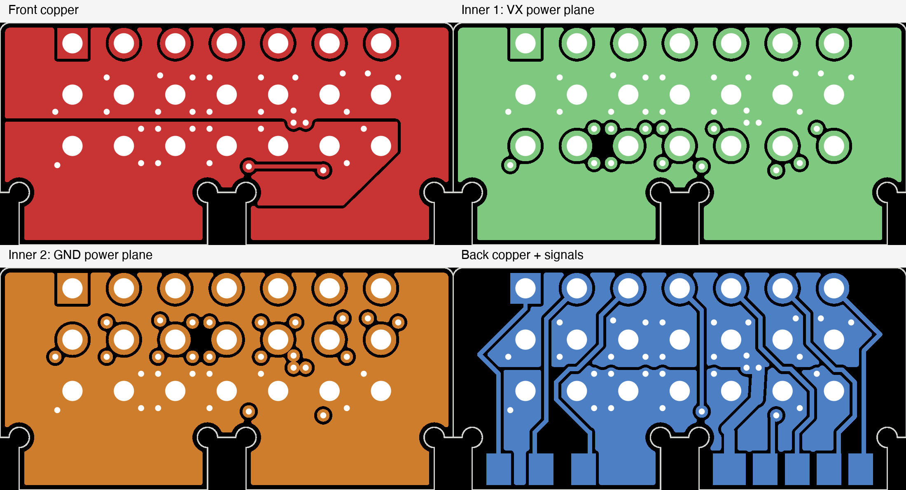
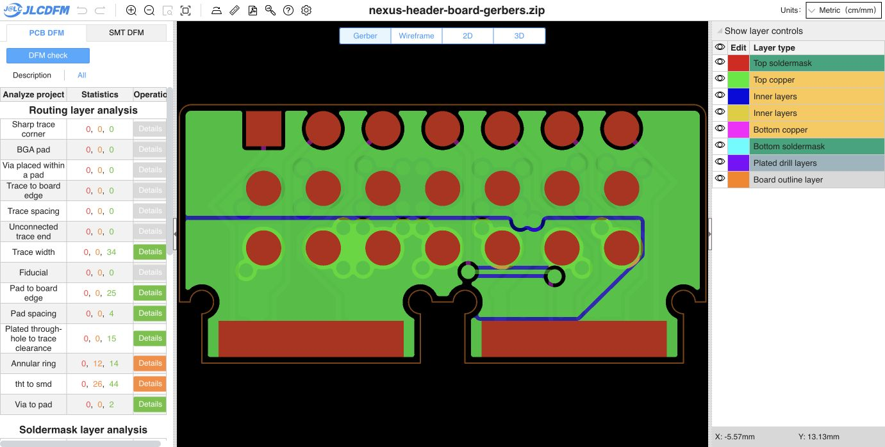

# Applied four-layer child power upgrade

The working child board now has dedicated inner VX and GND planes, a rear VX pour and 27 additional power vias. The exact connector placement, pinout, joint contacts, outline, original tracks and original via geometry are preserved. At the same 19.6 A imposed load and 0.075 mm grid, calculated copper/barrel loss decreases from **0.767 W to 0.282 W, approximately 63%**. A finer 0.050 mm grid gives **0.275 W**. This meets the earlier illustrative 0.4 W electrical-loss objective for dual feeds; it does not establish temperature rise or a complete-system current rating.

## Current source and manufacturing files

- Previous child SHA-256: `b49ef4108ab0b85d4cd96fac22553e3bc16b214f5acde148a8680e1212097ee6`.
- Applied child SHA-256: `12d537492ebb7aa347e30c78c758efbdbd6e238425f0095282cbf7188e872e23`.
- Main PCB remains `6295c7ebda6c8a4035064f235072d56e1d6e0ff1b7e6b0402f908ce372ae901e`.
- Current child Gerber ZIP SHA-256: `ca6a7e6410abf1cfb0b2522a902f7516565ab8eb29ecb883b0e1aa935f2121c3`.
- Fourteen ZIP members match the loose Gerber/job/drill files exactly, including both inner-plane Gerbers. Child BOM/CPL and every main manufacturing file remain unchanged.

The [input binding](input-binding.json), [explicit applied delta](applied-delta.json) and final verification bind the current source and preserved files. The baseline is recoverable from Git commit `c7ae78a43ae98d84b94fc5d124433f45643c421b`; experiment CAD copies are not retained as alternative working boards.

## Physical layout and stack

The 22.4 x 11.0 mm envelope, tab profiles, header position, pad geometry, signal routing and nominal 1.6 mm board thickness are unchanged. The original 71 tracks and 5 vias are preserved. There are now 32 vias: 19 VX, 11 GND and 2 TAIL. The 27 added vias use 0.60 mm lands / 0.30 mm drill and the board's existing tenting settings. They are distributed around the power/return header rows after checking copper, hole and track-end clearance; no signal rerouting was required.

Layer assignment:

| Layer | Function | CAD copper |
|---|---|---:|
| F.Cu | Existing VX/GND copper and retained short TAIL route | 70 um |
| In1.Cu | Continuous VX power plane | 61 um |
| In2.Cu | Continuous GND power plane | 61 um |
| B.Cu | Existing signals/power branches, rear VX pour and GND copper | 70 um |

JLC's [live stackup selector](https://jlcpcb.com/impedance), captured in `jlc-four-layer-stack.txt`, lists **JLC041622-3313** for nominal 1.6 mm / 2 oz outer / 2 oz inner copper. Its displayed outer prepreg pair is 0.107 + 0.0765 mm on each side and its core dielectric is 0.960 mm. CAD follows those values; the sum including nominal masks is 1.609 mm while the nominal board thickness/order remains 1.6 mm. Final complete thickness, copper/plating minima and matched-tab fit require supplier acceptance. The stack selection does not make this an impedance-controlled signal design. See the [required fabrication notes](../../../../manufacturing/nexus-header-board/FABRICATION-NOTES.md); substituting default thin inner copper invalidates this calculation.

## Candidate comparison and electrical calculation

A two-layer candidate with the rear VX pour and local stitching gave **0.562 W** on the 0.075 mm grid. It improved the original board but did not reach the proposed loss target, so two inner power planes were added. Placing VX on In1 and GND on In2 performed better than the reversed assignment for the evaluated feed cases. Both inner planes remain continuous after native refill; rear outer pours remain divided by retained signal routes, with the new planes and stitching providing parallel paths.

The load is 5/5/5/3.5 A at S1/S2/S3/TAIL plus an abstract 1.1 A main-board load: 19.6 A total. The servo currents are rounded upper-graph readings at 7.4 V, not exact guaranteed maxima, normal flight consumption or permission to hold servos near stall continuously. The [BEC/servo review](../bec-servo-power-2026-10-17/REVIEW.md) contains the primary KST/Hobbywing source evidence and original load-budget reasoning.

Native saved copper was extracted and solved as finite resistor sheets on each layer. The multilayer model uses **60 um outer / 55 um inner**, prescribed **80 C**, **95% IACS**, **18 um barrel walls**, and the earlier **0.97 mm header-bore resistance sensitivity**. Header lands and vias have separate ideal electrodes on each face/layer, connected by finite **adjacent-layer barrel segments**. Copper-center distances follow the selected stack, scaled to a conservative 1.65 mm full F-to-B barrel length. The solver does not connect every layer directly through an ideal short. All feed/servo loads enter from B.Cu; the main load is checked at both the small and broad child joint contacts.

The material minima are proposed calculation bounds, not guaranteed values inferred from nominal oz. Header pin/solder parallel conduction is excluded, so actual layer-transfer current may share with additional conductive paths. Within-land crowding, joints, actual mating contacts, output leads, main PCB copper/regulators, actual BEC dynamics and equilibrium temperature are not solved.

Same-grid comparison, 0.075 mm, main load at the small joint:

| Feed case | Previous child loss | Four-layer loss |
|---|---:|---:|
| Matched dual feeds | 0.767 W | 0.282 W |
| Unequal dual feeds | 0.787 W | 0.262 W |
| ESC only | 0.937 W | 0.292 W |
| SBUS only | 1.286 W | 0.495 W |

For matched dual feeds, sheet loss falls from 0.385 to 0.169 W and barrel loss from 0.382 to 0.114 W. Worst board-only servo-pad drops with one surviving feed fall from 52.2 to 17.4 mV (ESC) and 70.0 to 27.6 mV (SBUS). These exclude the external input lead/contact voltage drop. Dual feeds use synthetic 20 mOhm per conductor; the unequal case uses 20/80 mOhm feed pairs, and the surviving single pair uses 40 mOhm per conductor. They are stress assumptions, not measured harness values. The actual location of the second BEC plug must be checked; this benchmark uses ESC and an otherwise unused SBUS power pair from the same BEC.

Three grid resolutions give matched-dual/small-joint loss of 0.2881 W (0.100 mm), 0.2824 W (0.075 mm) and 0.2755 W (0.050 mm). The last refinement changes the result by approximately 2.4%. Both main-joint options and all four feed cases were solved on each grid, 24 solves. Maximum network residual is below 2.5e-10 A and maximum absolute power-balance error below 3.1e-7 W. These numerical checks do not quantify local thermal uncertainty.

Receipts: `four-layer-geometry.json`, `four-layer-sheet-model.json`, `four-layer-full-load.json`; rejected two-layer geometry, matrices and results are separately named. Read-only reproduction uses native KiCad Python for `extract_candidate.py`, then a NumPy/SciPy/Shapely Python environment for `mesh_multilayer.py` and `solve_multilayer.py`. The canonical board is the sole current CAD source. 80 C is a resistivity input, **not a predicted operating temperature**. At 0.275 W, a proposed 20 C lumped rise budget would require effective thermal resistance no greater than approximately 73 C/W, and local hotspots still need separate verification.

## Native and fresh website checks

Native KiCad DRC on the working child reports **zero error-level violations, zero opens and zero schematic-parity findings**. Eleven existing missing-courtyard warnings on bare joint/contact footprints remain; no rules or exclusions were relaxed. See `current-child-drc.json`. The board opens in native PCB Editor with all four copper layers and 32 vias; `preview/native-child-editor.png` records the visible saved result.

The exact new ZIP was uploaded to a distinct [JLCDFM check](https://jlcdfm.com/viewer?pcbUploadFileId=634333759018323969). The viewer recognizes two inner copper layers. The 29 PCB categories show **0 danger and 38 warnings**: 12 annular-ring and 26 through-hole-to-SMD proximity warnings. The previous two-layer child report had 6 annular-ring and 26 proximity warnings. Trace width/spacing, pad spacing, corners, mask checks and drill spacing report no warnings. Website result counts are primitive/check counts and do not guarantee complete coverage; some zero-count categories may have no measured objects. The six additional annular warnings must not be described as unchanged or all-green DFM. Native 0.15 mm via annuli satisfy the retained board rule; the website's warning boundary differs. No annular rule or factory process was relaxed to hide those findings. Current PCB screening does not rerun the prior header assembly/edge check or qualify the 2 oz process.

## Remaining limits

This completes the authorized PCB copper upgrade for the approximately 20 A electrical design screen. It does **not** establish a complete assembled 20 A continuous rating. The retained header is documented at 3 A/contact; the current V4 BEC is 10 A continuous / 25 A peak with no bound peak duration here. Their limits cannot be removed by adding PCB layers. Actual mating contacts/harness, current sharing, minimum delivered voltage, transient/RMS current, local temperatures, supplier stack/minimum plating, physical joint/fit and inherited main-board release gates remain open. No powered bench test, order or fabrication approval was performed.
