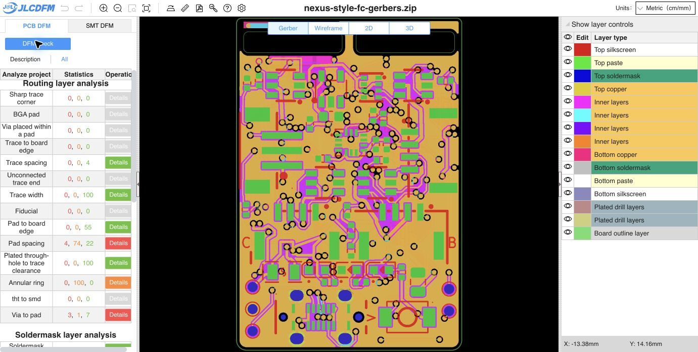

# Owner cleanup: regenerated Gerbers and fresh PCB DFM

Gerbers were regenerated from the owner's newly saved cleaned-up PCB. No source geometry, placement, via, net, rules, project or schematic edits were made by this export. Native zone refill reproduced the incoming PCB bytes exactly.

- PCB SHA-256: `879ab12e779adc1aa896c2096727d5aef557f6a34afa0420f9248c9a22098d99`
- Gerber ZIP SHA-256: `2c34a82eef28ffe9e8d3136ec3c813c074b04dae264a9ba43d42744ef31f6729`
- Native copper DRC: zero violations and zero unconnected items; the same 10 schematic parity warnings remain.
- Minimum outer track width: 0.14 mm, verified across the full native segment inventory.
- Regenerated ZIP integrity and all 16 loose Gerber/drill/job members verified.
- BOM (51 groups) and corrected CPL (83 placements) reproduce byte-for-byte. SMT was not rerun for this copper revision. Child source/CAM remain unchanged.
- [Exact input binding](input-binding.json), [native DRC](drc.json)

Fresh [JLCDFM PCB check](https://jlcdfm.com/viewer?pcbUploadFileId=634268113220100098) completed. Trace width is **0 danger, 0 warning, 100 Good**. Sharp corners retain zero danger/warning; trace spacing retains zero danger/warning and four Good results. Pad-spacing warnings decreased **77 → 74**, with Good results increasing **19 → 22**; its four danger results remain. All other category counts match the preceding width-final check. Website tables can be capped; these are displayed counts.

[Full category capture](pcb-summary.json) and [comparison](dfm-comparison.json) are retained. Source/CAM hashes were verified again after the website check.

Earlier reports remain bound to their original inputs. Release status remains **HOLD** for other PCB, prior assembly/model and engineering qualification gates.
