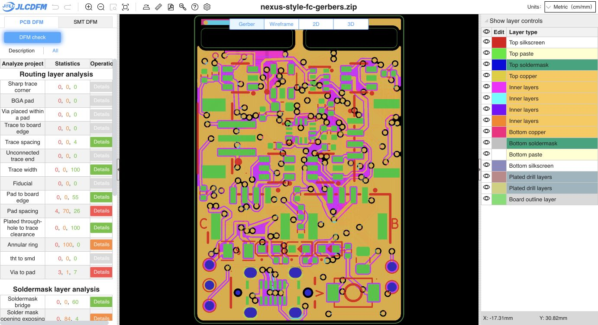

# Latest owner cleanup: regenerated Gerbers and fresh PCB DFM

Gerbers were regenerated from the owner's latest saved cleanup. No source geometry, placement, via, net, rules, project or schematic edits were made by this export. Native zone refill reproduced the incoming PCB bytes exactly.

- PCB SHA-256: `a3b909c78c7784865a77dcbf323432dce4b60e81fec0b5fde49ad273ffcfaafc`
- Gerber ZIP SHA-256: `2bfe65d4c1b121986d4581d7f0ff33220a7fc215837fb347b4fcf5dbe6b82055`
- Native copper DRC: zero violations and zero unconnected items; the same 10 schematic parity warnings remain.
- Minimum outer track width: 0.14 mm, verified across the full native segment inventory.
- Regenerated ZIP integrity and all 16 loose Gerber/drill/job members verified.
- BOM (51 groups) and corrected CPL (83 placements) reproduce byte-for-byte. SMT was not rerun for this copper revision. Child source/CAM remain unchanged.
- [Exact input binding](input-binding.json), [native DRC](drc.json)

Fresh [JLCDFM PCB analysis](https://jlcdfm.com/viewer?pcbUploadFileId=634285895248465922) completed. Trace width is **0 danger, 0 warning, 100 Good**. Sharp corners retain zero danger/warning; trace spacing retains zero danger/warning and four Good results. Pad-spacing warnings decreased **72 → 70**, with Good results increasing **24 → 26**; its four danger results remain. All other category counts match the preceding cleanup check. Website tables can be capped; these are displayed counts.

[Full category capture](pcb-summary.json) and [comparison](dfm-comparison.json) are retained. Source/CAM hashes were verified again after analysis.

Earlier reports remain bound to their original inputs. Release status remains **HOLD** for other PCB, prior assembly/model and engineering qualification gates.
