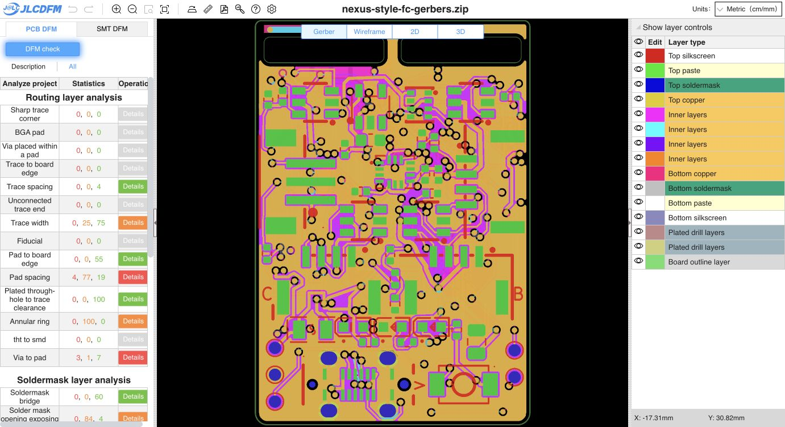

# Current saved PCB: regenerated Gerbers and JLCDFM reupload

The main Gerbers were regenerated from the current saved PCB and uploaded to [JLCDFM](https://jlcdfm.com/viewer?pcbUploadFileId=634257778601578498). PCB analysis completed; the live result is kept open. This export made no source geometry changes. The incoming PCB, schematic, project, rules and assembly files were preserved. The child CAM was not regenerated.

- Main PCB SHA-256: `8c109c21d65a0f2d96d46a9c2bfc015682f0abca18d39f24c0cc578b59fb450d`
- Uploaded ZIP SHA-256: `28d23d236bebd51531aad1519dd7805a5534dafbd78b6c5d6bacc1cb4cc94649`
- ZIP integrity verified; all 16 archive members match the loose manufacturing exports.
- Native KiCad 10.0.6 DRC: zero copper violations, zero unconnected items, 10 schematic footprint-parity warnings (nine symbol mismatches and one footprint-filter mismatch).
- The 51-group BOM and corrected 83-placement CPL reproduce byte-for-byte. SMT analysis was not rerun for this export.
- Source and export hashes were checked again after the website analysis. See [input binding](input-binding.json), [native report](drc.json) and [website capture](pcb-summary.json).

Sharp trace corners: zero danger/warning. Trace spacing: zero danger/warning, four good results. Trace width: zero danger, 25 warnings, 75 good results. Website counts can be capped and do not correspond one-for-one to native track segments.

| PCB category | Danger | Warning | Good |
| --- | ---: | ---: | ---: |
| Sharp trace corner | 0 | 0 | 0 |
| BGA pad | 0 | 0 | 0 |
| Via placed within a pad | 0 | 0 | 0 |
| Trace to board edge | 0 | 0 | 0 |
| Trace spacing | 0 | 0 | 4 |
| Unconnected trace end | 0 | 0 | 0 |
| Trace width | 0 | 25 | 75 |
| Fiducial | 0 | 0 | 0 |
| Pad to board edge | 0 | 0 | 55 |
| Pad spacing | 4 | 77 | 19 |
| Plated through-hole to trace clearance | 0 | 0 | 100 |
| Annular ring | 0 | 100 | 0 |
| tht to smd | 0 | 0 | 0 |
| Via to pad | 3 | 1 | 7 |
| Soldermask bridge | 0 | 0 | 60 |
| Solder mask opening exposing trace | 0 | 84 | 4 |
| Soldermask opening with multiple segments | 0 | 0 | 0 |
| Negative soldermask expansion | 0 | 10 | 0 |
| Silkscreen to pad | 100 | 0 | 0 |
| Silkscreen to hole | 100 | 0 | 0 |
| Silkscreen line width | 0 | 52 | 4 |
| Unconnected via | 0 | 0 | 0 |
| Missing plated through-hole | 0 | 0 | 0 |
| Unconnected via | 0 | 0 | 0 |
| Plated through-hole spacing | 0 | 0 | 1 |
| Short slot detection | 0 | 4 | 0 |
| Slot width check | 4 | 0 | 0 |
| Via to PTH spacing | 0 | 0 | 0 |
| Unconnected via | 0 | 0 | 0 |

The earlier width, TAIL and corner/spacing reports remain bound to their original inputs. This current export follows additional saved owner edits; older findings must not be treated as the result for this ZIP.

Release status remains **HOLD**. Pad-spacing, via-to-pad, slot-width, silkscreen and other PCB findings remain, together with the prior assembly/model and engineering gates in the validation index. This check establishes CAM screening, not fabrication or flight qualification.
