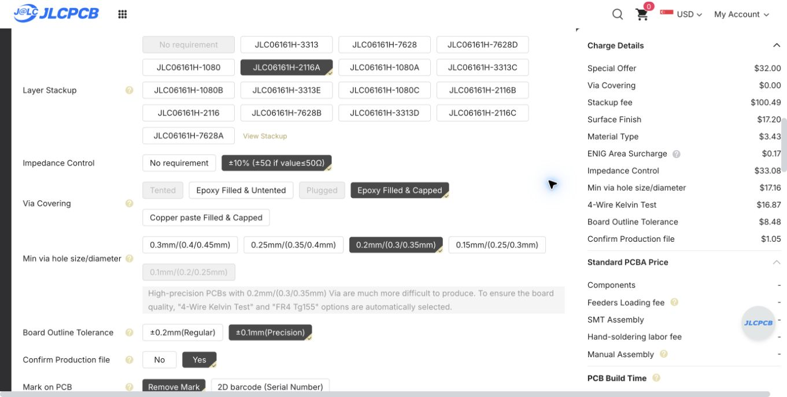
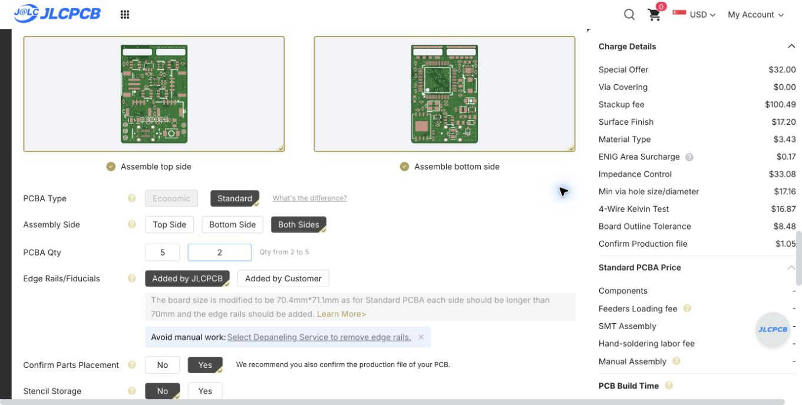

# Historical custom-stack quote — 17 October 2026

Superseded by the [standard-stack quote and no-paid-impedance-test selection](../standard-stack-2026-10-17/REVIEW.md). The settings and prices below describe the earlier form only.

Filled the user's existing Chrome quote tab and left it on the quote form. NEXT, cart submission and payment were not performed; the assembly-terms checkbox is unchecked. BOM/CPL upload belongs to a subsequent step and was not opened.

The uploaded `nexus-style-fc-jlc-quote.zip` contains the exact 16 current DFM CAM members plus `IMPEDANCE-CONTROL.jpg`, satisfying the form's request for a JPG/Excel impedance sheet inside the ZIP. All original CAM members were verified byte-identical. [Upload binding](upload-binding.json), [selected options](selected-options.json), [page evidence](quote-page.txt).

Selections: five fabricated boards; two Standard assembled boards, both sides; green/white, FR4 TG155, six layers, nominal 1.6 mm, ENIG 1u inch, 1 oz outer / 0.5 oz inner, JLC06161H-2116A; explicit F/In1/In2/In3/In4/B layer sequence; 90 ohm differential +/-10% requirement in the uploaded sheet; epoxy filled and capped vias; 0.20 mm minimum via hole option. Native holes are 228 vias at 0.45/0.20 mm. Production-file and part-placement confirmation require manual approval (automatic approval disabled).

JLC Standard assembly automatically adds rails and changes quoted dimensions to 70.4 x 71.1 mm; the detected board remains 22.4 x 33.1 mm. Rails/fiducials are added by JLC and depaneling before delivery is selected. Precision outline tolerance +/-0.1 mm is selected; assembly notes require at least three distributed 1.5 mm tooling holes in those rails, subject to factory production-file review. Quote stack acknowledgement lists 1.546 mm actual thickness +/-10%; the nominal order category remains 1.6 mm. Factory stack/material and matched-fit acceptance remain necessary.

PCB remarks specify USB impedance sheet, POFV for all 228 via holes, leaving the four 0.85 mm USB component holes open, J6 short-leg soldering review and manual production approval. Assembly remarks preserve exact C9/R23/C5/D4 identities, 150 mOhm rather than 150 ohm for R23, U10's already-corrected 270-degree CPL rotation, J6 joint review and stock/attrition confirmation.

Displayed PCB estimate is USD 229.93; components and assembly are still unquoted on this page, with USD 9.66 shipping estimate separate. This is an unsubmitted quote, not an accepted order or factory signoff. The child is a separate PCB quote and was not entered on the main-board form.

