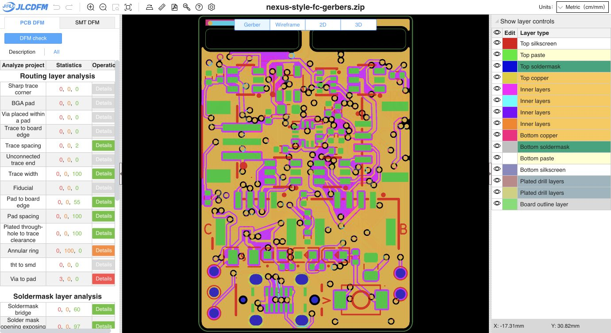

# Owner VX and 3V3 cleanup recheck

**The latest owner route cleanup passes native DRC with zero violations and zero opens, retaining exactly the same ten inherited schematic-parity findings.** No route correction was needed or applied during this recheck.

The owner changed VX and 3V3 segments on In3.Cu. The VX upper cross-feed and trunk entry use 0.60 mm routing with cleaner junctions; a separate 3V3 path is simplified. VX straight-trace length on In3 decreases from 53.5303 to 52.5162 mm, and 3V3 from 18.7911 to 18.6130 mm. Other layers' route lengths are unchanged. Exact footprint, pad, via, stackup/setup, physical board/slot outline and keepout geometry are preserved relative to the preceding corner-width review. There are 1969 straight segments, 16 arcs, 227 vias and 89 footprints. [Owner source delta](source-diff.json), [verification and route metrics](verification.json).

The initial owner save had stale cached fills. Native refill on a copy passed DRC, and saving the current editor state produced the exact same refilled PCB bytes. All source route geometry and zone definitions are preserved; only the cached fill data changed. [Native DRC](drc.json).

Main-only Gerbers/drills/job were regenerated as a 16-member ZIP, with each member checked against its loose export. The 51-group/83-part BOM, 83-placement CPL, main project, schematic and DRC rules remain byte-identical to the preceding check. The child PCB and CAM are unchanged; an existing owner edit to the child's project settings is outside this recheck and was preserved. SMT was not rerun. [Exact input binding](input-binding.json).

The [fresh PCB DFM result](https://jlcdfm.com/viewer?pcbUploadFileId=634325109695401986) matches all 29 category triples from the preceding upload. Trace width, trace spacing, pad spacing, sharp corners, soldermask bridges and mask opening exposing trace remain zero danger/zero warning. Existing negative-mask, via-to-pad, slot, annular-ring and silkscreen findings retain their preceding counts. [Full counters](pcb-summary.json), [comparison](dfm-comparison.json) and [visible UI](pcb-dom.txt).

- Initial owner saved PCB SHA-256: `0d720051b8b4501ba5e3ed75ab157c2d06c9acfa7d18d26f3965d68eabd42b49`
- Current refilled PCB SHA-256: `6295c7ebda6c8a4035064f235072d56e1d6e0ff1b7e6b0402f908ce372ae901e`
- Gerber ZIP SHA-256: `4b81b0e6ab44bef2473c147313851019d8dbb530e6e104ebc40899e26caff44c`

**Release remains HOLD** for inherited fabrication, assembly/process and electrical/mechanical qualification gates. C8's via-in-pad still requires confirmed epoxy filling and copper capping. This numerical recheck establishes no physical or current-rating qualification.
