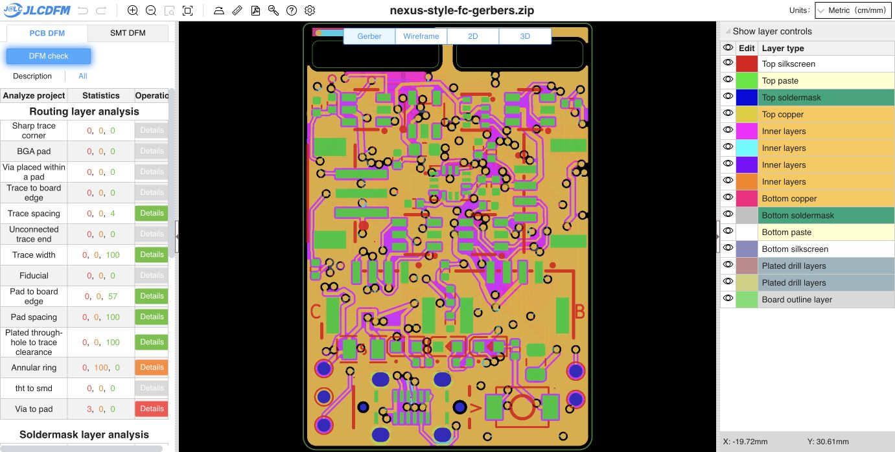

# Pad-spacing correction

The [fresh JLCDFM PCB check](https://jlcdfm.com/viewer?pcbUploadFileId=634296846603776002) reports **pad spacing: 0 danger, 0 warnings, 100 Good**, compared with 4 danger / 69 warnings / 27 Good on the incoming PCB. Trace width, trace spacing and sharp corners remain green. The website caps displayed results; the full native geometry and copper checks are recorded independently.

The correction moves 121 of 227 vias and adjusts connected traces on the relevant copper layers. Via count, drill sizes, diameters, layer spans and net assignments are unchanged. Most moves are local; the A_TX layer transition was relocated by about 2.584 mm to escape a gap between the fixed header and MCU pad fields. Its previous route detour was removed: total A_TX trace length decreases from 15.466 to 12.814 mm. Native connectivity remains complete.

Five component positions change while their pad geometry, identities, sides and orientations remain unchanged:

| Component | Native X change | Native Y change |
| --- | ---: | ---: |
| C31 | 0 | -0.025 mm |
| R20 | +0.025 mm | 0 |
| R21 | +0.025 mm | 0 |
| U10 | 0 | +0.025 mm |
| Y1 | 0 | +0.030 mm |

The small crystal shift opens the B_TX via gap beside the MCU. The LDO adjustment clears its pad-to-via gap; C31 and the USB resistors open their local spacing. Every other footprint, including all header/mating geometry, is preserved exactly. The child is unchanged. The [geometry verification](geometry-verification.json), [full copper diff](final-copper-diff.json), [component moves](component-moves.json) and [net route metrics](net-route-metrics.json) record the complete scope. Existing track widths, layers and net assignments are unchanged; all outer tracks remain at least 0.14 mm. The outline, stack, keepout/zone definitions, rules, schematic and project are unchanged. No DRC exclusions or clearance relaxations were added.

Final native KiCad 10.0.6 [DRC](drc.json): **zero copper violations, zero unconnected items**. The ten inherited schematic footprint-parity warnings have identical types, descriptions and UUIDs; only Y1's warning coordinates follow its position shift. Zone fills were refreshed with matching native project/rules.

The exact 16-member Gerber/drill/job ZIP screened on the website was copied to manufacturing. The 51-group BOM is byte-identical. The 83-placement CPL was regenerated; [only the five expected coordinate rows change](cpl-position-changes.json), with all rotations/sides/reference coverage preserved. SMT was not rerun for this copper/placement revision.

- PCB SHA-256: `d559c9f926ca5481d2b7a4804515600edb6ee63832a2dd913d03a1fc9e044461`
- Gerber ZIP SHA-256: `5aef9aa96c4140bf6e8b914ef304e8b40781bb7b1a93ae923d6746a416a157c4`
- CPL SHA-256: `a1b1d473b10db6da62d60b91f2ffded6eb5f6cf772b0e4c902421ccbc9f2bcd3`
- [Input binding](input-binding.json), [website capture](pcb-summary.json), [category comparison](dfm-comparison.json)

Other PCB findings remain, including three via-to-pad and four slot-width danger flags, capped silkscreen findings and mask/annular-ring warnings. Prior assembly/model and engineering qualification gates remain open. **Release remains HOLD**. This is fabrication screening, not electrical, SI/PI, assembly-fit or flight qualification. Reload the PCB in an already-open KiCad editor before saving, to retain the new file changes. Historical reports keep their original bindings.
