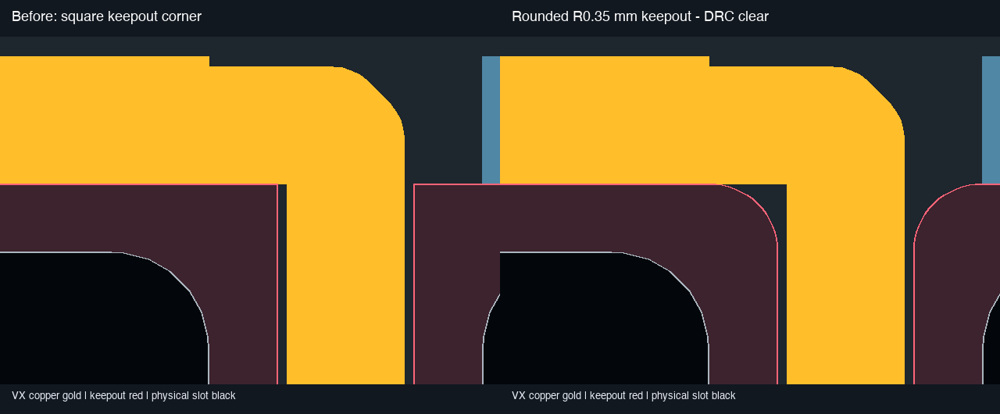
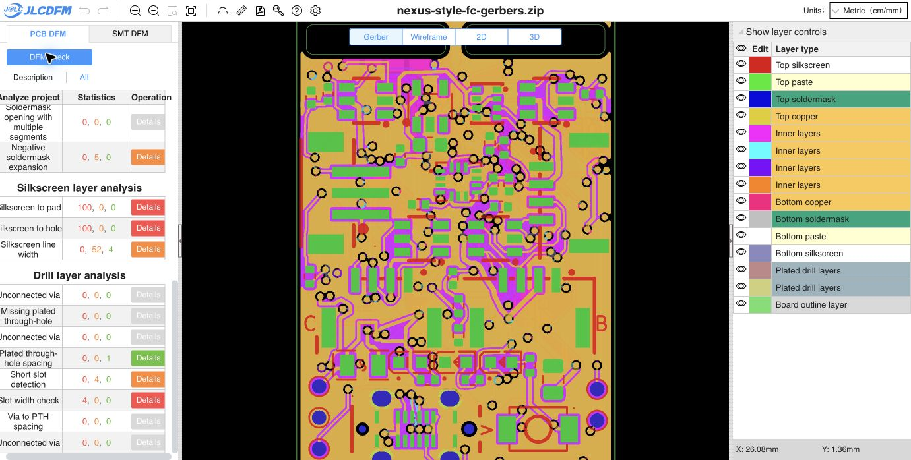

# Rounded header-slot routing keepouts

**Both header-slot routing keepouts now have R0.35 mm corners. The saved main board passes native DRC with zero violations and zero opens, retaining the same ten inherited schematic-parity findings.** The latest owner VX route and removed GND via are preserved.

The earlier `Items not allowed` finding identified the B.Cu VX diagonal touching the square corner of the left rule area. Rounding removes that square corner while retaining the entire physical slot plus its nominal 0.35 mm buffer. Both rule areas retain the original extents, all six copper layers, track/via prohibitions and other flags. The physical slots and global 0.30 mm copper-edge rule are unchanged. Corner curves use 16 short polygon chords per quarter, with less than 0.000423 mm radial chord approximation error. [Corner geometry](geometry-change.json).

The latest saved owner PCB was used after the owner paused editing. Its shorter 0.60 mm VX entry, all other tracks/arcs, all 227 remaining vias, footprints, pads, stackup and physical board/slot outlines are exactly preserved by this change. Only the two rule-area contours and refreshed fills differ. The editor was reloaded from disk to retain the new contours on subsequent saves. [Native DRC](drc.json), [geometry verification](verification.json), [source/CAM binding](input-binding.json).

The main-only 16-member Gerber/drill/job ZIP was regenerated from the final saved board; every ZIP member matches its loose manufacturing file. BOM/CPL, project, schematic, DRC rules, child board and child exports are unchanged. The BOM remains 51 groups/83 parts. SMT was not rerun.

The [fresh final PCB DFM check](https://jlcdfm.com/viewer?pcbUploadFileId=634320551360815106) preserves all 29 category triples from the preceding VX upload. Trace width, trace spacing, pad spacing, sharp corners, soldermask bridges and mask opening exposing trace retain zero danger/warning. [Counters](pcb-summary.json), [comparison](dfm-comparison.json) and [visible UI](pcb-dom.txt). An intermediate upload was superseded when the owner saved a shorter entry; this final upload matches the ZIP bound below.

- Main PCB SHA-256: `325f6b82a1bfed9dbaa496864c878cbde18e79ae07dbeec0f973d79def0f672e`
- Main Gerber ZIP SHA-256: `8d809bb687d5213081f9a67c753eada6df8e33713f98e2af355913ca25760712`

**Release remains HOLD for inherited process, fabrication/assembly and electrical/mechanical qualification gates.** C8's via-in-pad still requires confirmed epoxy filling and copper capping (POFV). Existing slot-width, via-to-pad, negative-mask, annular-ring and silkscreen findings are not cleared by this rule-area edit. No current-rating or physical qualification is established.
