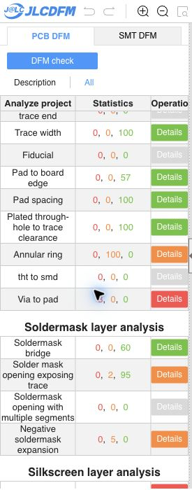

# Solder-mask warning correction

The [fresh JLCDFM PCB check](https://jlcdfm.com/viewer?pcbUploadFileId=634303030647844866) of the exact saved main-board Gerbers reports **mask-opening-to-trace warnings: 82 to 2**, and **negative-expansion flags: 10 to 5**. Solder-mask danger counts remain zero. Pad spacing, trace width, trace spacing and sharp corners retain zero danger and zero warnings. The website caps displayed findings at 50 per layer; the recorded category counters are screening results, not exhaustive electrical qualification.

| Solder-mask category | Danger | Warnings | Good |
| --- | ---: | ---: | ---: |
| Bridge | 0 | 0 | 60 |
| Opening exposing trace | 0 | 2 | 95 |
| Opening with multiple segments | 0 | 0 | 0 |
| Negative expansion | 0 | 5 | 0 |

## Changes and preserved geometry

An added custom rule requires **0.17 mm clearance between outer copper zones and pads**, so ground pours no longer approach exposed pads at the previous 0.127 mm clearance. The existing manufacturing floors are unchanged and no exclusions are added. The five 1 mm test-point pads TP1-TP5 receive **+0.01 mm mask expansion**; their copper and paste geometry are unchanged.

Outer routing adjusts to improve mask clearance. The routing solver's largest node displacement before the final capacitor adjustments is about 0.036 mm. C9 moves +0.025 mm in X and C11 moves -0.025 mm in X, with their attached trace ends updated. The GND route beside C11 shifts another 0.008 mm. No other footprint positions, orientations, part identities, copper pad shapes or nets change. The outline, stack, 227 vias and 16 track arcs are unchanged. All four inner-layer pours and all inner-layer tracks are unchanged; [zone areas](zone-area.json) record the outer-pour clearance change.

A 0.757 mm portion of the high-impedance VX_SENSE ADC line uses a **0.14 mm neck** instead of 0.2 mm to fit its pad corridor. Nine final segments form this neck; three original segment UUIDs change width. Other original widths are preserved. All outer traces remain at least 0.14 mm. Overall, 208 original straight segments change and 139 segments are added to form the local bends. [Geometry verification](geometry-verification.json), [complete copper changes](copper-changes.json), [ADC neck](adc-neck-segments.json), and [native net lengths](net-route-metrics.json) record the scope. USB_DP length is unchanged; USB_DN changes by about -0.0017 mm. These checks do not establish SI/PI or electrical qualification.

## Remaining mask findings

The **two real clearance warnings** are the bottom LED2_K trace passing between C8's two pads. The pad gap is 0.400 mm and the trace is 0.140 mm, leaving about 0.130 mm on each side. This cannot reach the website's green threshold while keeping that path and the 0.14 mm minimum width. A local route search around C8 and a scan for an earlier through-via transition found no path/position meeting the checked local copper and pad clearances. That search was not adopted. Removing these warnings requires a broader LED reroute or placement change. [Bottom details](exposure-bottom.txt), [top details](exposure-top.txt), and [local route search outcome](local-led-route-search.json) preserve the evidence. The top side has no mask-to-trace warnings.

The **five bottom negative-expansion flags are not confirmed by the native/CAM geometry**. The four RoundRect findings and one custom U5 exposed-pad finding use zero native mask expansion. All 211 bottom pad-mask flashes have exactly the same Gerber aperture definition and coordinate as the corresponding copper pad; the RoundRect/custom macro definitions are also identical. The two other bottom mask flashes are non-plated mounting-hole openings. This supports an inference of JLCDFM pad-recognition/association issues rather than actual negative mask expansion. The apertures were retained. See the [aperture audit](mask-gerber-aperture-audit.json) and [website details](negative-expansion-details.txt).

## Validation and fabrication files

Native KiCad 10.0.6 DRC on the **adopted workspace PCB** reports **zero copper violations and zero unconnected items**. The ten inherited schematic footprint-parity warnings are exactly unchanged. The [DRC report](drc.json) and [input binding](input-binding.json) bind the current source and CAM; all zone refills used the matching project and custom rules.

The exact screened 16-member Gerber/drill/job ZIP and loose CAM files are now in manufacturing. The 51-group / 83-part BOM is byte-identical. The 83-placement CPL changes only C9 and C11 X coordinates; all rotations, sides, Y coordinates and reference coverage are preserved. The [CPL changes](cpl-position-changes.json) record those two rows. The child PCB/CAM and the main schematic/project are unchanged. SMT was not rerun for this revision.

- Main PCB SHA-256: `dd483bd15b4442319f7f0d55dcf8af7f147a90f3fc4f5a3365fe31522f08cf35`
- Gerber ZIP SHA-256: `3f5f49362695301ae327583e338ccdb80d8921063930f59084469fb5bd492f20`
- CPL SHA-256: `c9879522944e602dd861fe18854923b21254c2ddcb2840eb913474db8b35f69c`
- [Category comparison](dfm-comparison.json), [website capture](pcb-summary.json), [baseline binding](baseline-input-binding.json)

**Release remains HOLD.** Other findings remain, including three via-to-pad and four slot-width danger flags, capped silkscreen findings, annular-ring warnings, prior assembly/model/process findings and physical/electrical qualification gates. This is fabrication screening, not fabrication or flight release. Reload the PCB in an already-open KiCad editor before saving to retain these filesystem changes. Earlier reports and seals retain their original bindings.
