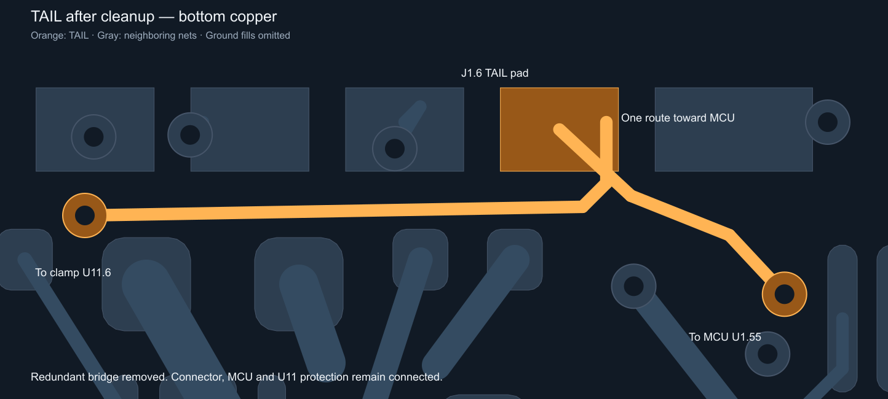

# TAIL loop cleanup — 17 October 2026

Removed the redundant B.Cu bridge from (107.350, 105.000) to (109.260798, 105.901932) mm. Trimmed the clamp-side horizontal track to (107.208, 105.012) mm so it ends exactly at its existing connector branch, without a leftover stub. One segment removed and one shortened; no new routing or vias.

The connector-to-MCU route stays unchanged. Native copper-shape connectivity verifies **J1.6, U1.55 and U11.6** remain connected in one TAIL component, including every TAIL routing item. All other nets, footprint/pad geometry, widths, layers, vias, stack/outline and zone definitions remain unchanged. Filled copper was regenerated with KiCad 10.0.7 using the matching project and rule files.

Final native DRC: **zero copper violations and zero opens**. The **10 pre-existing schematic/footprint parity warnings are unchanged**. ERC also reports two pre-existing PowerInductor/library-symbol warnings. The working schematic and project settings were preserved byte-for-byte. The earlier trace review's zero-parity result applies to its recorded earlier schematic/project checkpoint, not this working schematic.

Matching main Gerbers/drills were regenerated. The 51-group BOM and 83-placement CPL reproduce byte-for-byte; the child board and its outputs are unchanged. See [input binding](input-binding.json), [native DRC](drc.json), [ERC](erc.json) and [exact connectivity](connectivity.json).

Fresh JLCDFM checks of both the incoming board and final board completed. **All 29 PCB category counts are identical before and after:** sharp corners 0/0/0; trace spacing 0/1/4; disconnected trace ends 0/0/0. The 0.13 mm spacing warning in the unchanged IMU-area copper is already present on the incoming board; it was not introduced by TAIL cleanup. The previous green spacing report applies to its earlier recorded inputs.

[Final website result](https://jlcdfm.com/viewer?pcbUploadFileId=634250404738588673) · [Incoming-board comparison](https://jlcdfm.com/viewer?pcbUploadFileId=634251086769901570). The exact source/CAM hashes were verified again after the checks. Earlier DFM reports retain their original hashes. Other fabrication, assembly and engineering gates remain open; release status remains **HOLD**.

