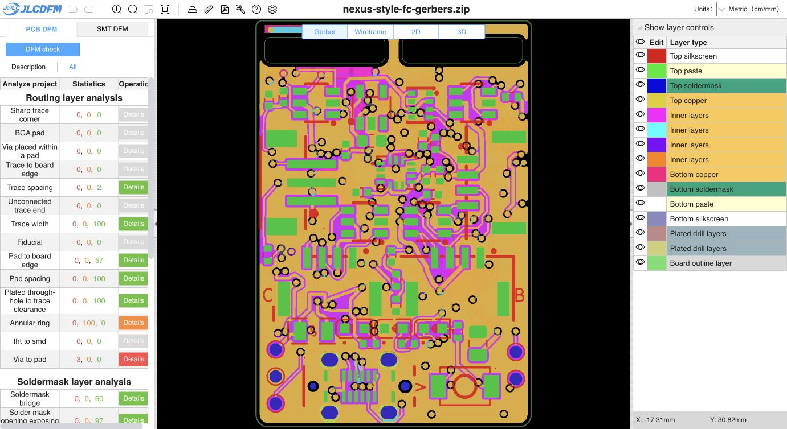

# Applied VX back link and wider inner copper

**The reviewed VX improvements are applied to the working main board and matching Gerbers. Native DRC reports zero violations and zero opens, and fresh JLCDFM preserves every preceding PCB category count.**

The [fresh PCB check](https://jlcdfm.com/viewer?pcbUploadFileId=634315833666396162) reports zero danger/warning for trace width, trace spacing, pad spacing, sharp corners, soldermask bridges and mask opening exposing trace. All 29 reported category triples match the preceding C8-via upload exactly; website counters are capped screening results, not fabrication or electrical qualification. [Comparison](dfm-comparison.json), [full counters](pcb-summary.json) and [visible UI](pcb-dom.txt) bind the result.

## Applied change

- Five new B.Cu VX segments connect the existing vias at (110.0, 100.75) and (109.7, 104.15), passing around the end of the left header slot through the central board web. Their total length is 5.954 mm: 1.750 mm at 0.30 mm width and 4.204 mm at 0.60 mm. No vias were added or moved. Existing inner paths remain connected in parallel.
- Approximately 66.536 mm of existing inner-layer VX segments are widened across In2.Cu and In3.Cu. The long In3 trunk increases from 0.50 to 0.60 mm, and the 5.277 mm cross-feed increases from 0.35 to 0.60 mm. The header passage widens from 0.18 mm to as much as 0.60 mm, with narrower sections retained around surrounding copper. All former 0.18 mm VX segments are now at least 0.20 mm; this does not mean every VX section is 0.60 mm.
- Two conservative header-slot keepout faces move toward the central web: left maximum X 111.1 to 110.85 mm, right minimum X 111.3 to 111.55 mm. The physical 9.80 mm slots and their 1.40 mm central board web are unchanged. The revised keepouts retain at least 0.35 mm from the straight slot end faces; a centred 0.60 mm passage has 0.40 mm nominal slot-edge clearance. The global 0.30 mm copper-to-edge rule remains unchanged.

The exact reviewed candidate was applied after verifying the predecessor PCB, project, rules, schematic, BOM, CPL and Gerber ZIP hashes. The [feasibility report and comparison image](../vx-feasibility-2026-10-17/REVIEW.md) explain the geometry, and its [exact track/rule-area delta](../vx-feasibility-2026-10-17/candidate-delta.json) matches this applied board.

## Validation and matching outputs

Native KiCad refill on the canonical board reports **0 violations, 0 unconnected items and the same 10 inherited schematic-parity findings**, compared exactly with the preceding review. [Native report](drc.json).

Exact footprint subtrees, pads, all 228 via records, all non-VX segments/arcs, stackup/setup, physical board/slot outlines, project, rules, schematic, BOM and CPL are preserved. Straight segment count rises from 1978 to 1997 because of width profiles and the five new back segments; all 16 arcs are unchanged. [Geometry verification and width/length metrics](verification.json).

The main-only Gerber/drill/job export contains 16 files. Every ZIP member matches its loose manufacturing file. The main BOM remains 51 groups/83 parts and the CPL retains its 83 placements and reviewed rotations, byte-identical to the predecessor. Child board and exports are unchanged. SMT was not rerun for this copper revision. [Exact file binding](input-binding.json).

- Main PCB SHA-256: `2a9da2179b386c6451b8c52c5a289751b53a4a88355ace81feb7416e28c29189`
- Main Gerber ZIP SHA-256: `fa8e58cb66ea52816b68055cc13b7b84bb82a3ca0f21767c4e530530e0ba8fe9`
- Child PCB SHA-256: `b49ef4108ab0b85d4cd96fac22553e3bc16b214f5acde148a8680e1212097ee6`

**Release remains HOLD for the inherited fabrication, assembly/process and electrical/mechanical qualification gates.** C8's existing 0.20 mm via-in-pad still requires epoxy filling and copper capping (POFV) confirmed in production. Five negative-mask recognition warnings, three via-to-pad and four slot-width dangers, annular-ring and silkscreen findings remain. Wider copper establishes no current rating or temperature-rise qualification, and the retained header rating remains 3 A per contact.
