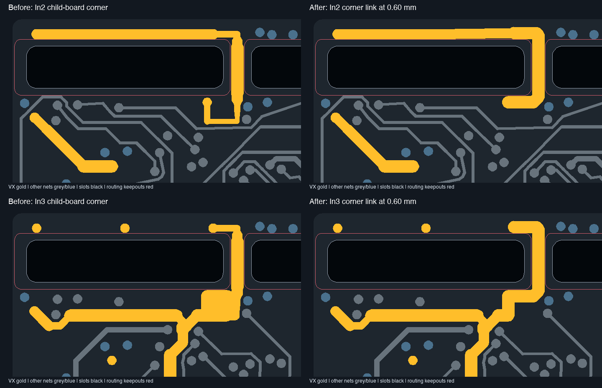
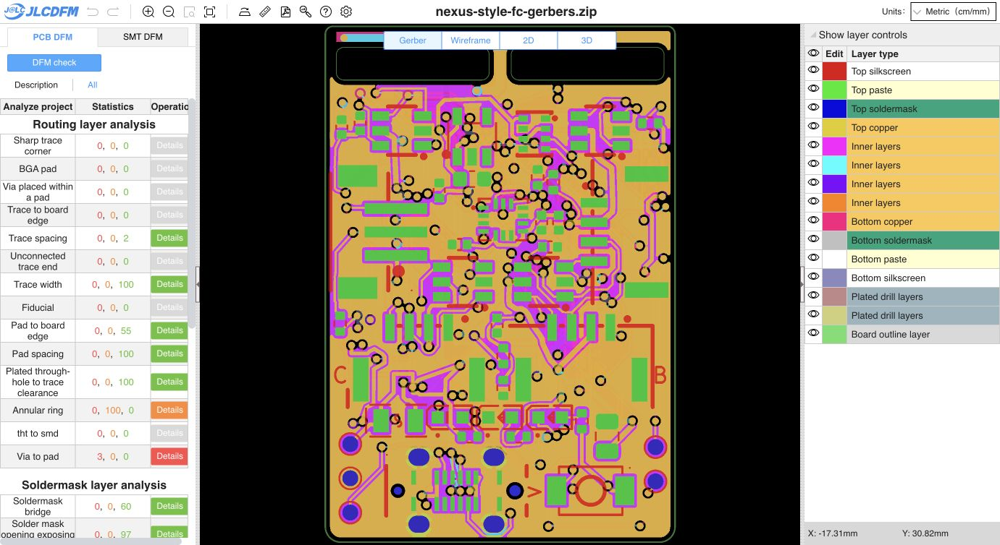

# Uniform VX width at the child-board corner only

**The VX links around the child-board slot corner are now 0.60 mm on In2.Cu and In3.Cu. Other VX trace widths are unchanged.** Native DRC reports zero violations and zero opens, with exactly the same ten inherited schematic-parity findings.

The old profiled corner loops are replaced by one shorter 5.953 mm path on each inner layer, following the existing back-layer corner link. Both run at 0.60 mm from the outer VX strip via to the inner VX contact via. The existing In3 connection into the wider board routing remains. Thirty-four old corner segments are replaced by ten new segments, all within the header corner region; the straight-segment count becomes 1973. All 16 arcs are unchanged.

The VX via at (110.0, 100.75) moves 0.06 mm toward the board edge to (110.0, 100.69), within the same VX contact pad. This provides a centred entry for the 0.60 mm trace while keeping it clear of the slot keepout. Its 0.45 mm diameter and 0.20 mm drill are unchanged. The existing In2 0.50 mm header-strip segment follows that endpoint; its width remains 0.50 mm. All other vias and all outer-layer track records are unchanged; there are still 227 vias. The owner's removed GND stitch remains removed.

Exact footprint/pad, physical slot/board outline, stackup/setup, keepout and DRC-rule geometry is preserved. No other-net routing or component placement changes are made. All other VX track widths retain their prior values. [Exact source delta](source-delta.json), [corner path](corner-route.json), [verification](verification.json), [native DRC](drc.json).

The saved board was reloaded into the PCB editor. Main-only Gerbers/drills/job were regenerated as a 16-member ZIP, with every member verified against its loose export. The 51-group/83-part BOM, 83-placement CPL, project, schematic, rules, child board and child CAM remain unchanged. SMT was not rerun. [Exact source/CAM binding](input-binding.json).

The [fresh PCB DFM check](https://jlcdfm.com/viewer?pcbUploadFileId=634322717221842946) preserves all 29 danger/warning count pairs. Width, spacing, pad spacing, sharp corners, mask bridges and mask-to-trace remain green. Pad-to-board-edge Good count changes from 57 to 55, while its danger/warning counts remain zero; native edge rules also pass. [Full counters](pcb-summary.json), [comparison](dfm-comparison.json) and [visible UI](pcb-dom.txt).

- Main PCB SHA-256: `b27cbef262acea5e87eab3c70cb4e5646e7aea918fef576c222bc2b26b0604d1`
- Gerber ZIP SHA-256: `ac9b096a1ced9a6181ce2dbaf52c2b0edb9e774f2dcfcb5494c5429cf512cef8`

**Release remains HOLD** for inherited fabrication, assembly/process and electrical/mechanical qualification gates. C8's via-in-pad still requires confirmed epoxy filling and copper capping. This local width change establishes no current rating or physical qualification.
