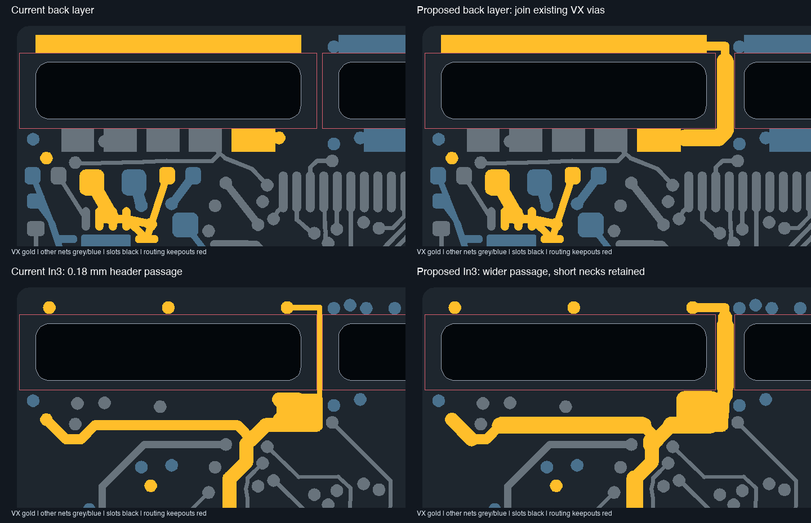

# VX copper feasibility review

**Both improvements are feasible in an isolated candidate: add a back-layer VX link around the header slot ends, and widen clearance-safe inner-layer VX sections. No changes from this review have been applied to the working PCB, Gerbers, BOM or CPL.**

## Recommended candidate

- Add a 5-segment B.Cu connection between existing VX vias at (110.0, 100.75) and (109.7, 104.15). It runs through the central board web at x=111.2, around the right end of the left header slot. The first 1.75 mm is 0.30 mm wide because of the nearby GND via; the remaining approximately 4.20 mm is 0.60 mm wide. No new vias are needed. Existing inner-layer connections remain in parallel.
- Increase the long In3.Cu trunk from 0.50 to 0.60 mm, the clearance-safe 5.277 mm cross-feed from 0.35 to 0.60 mm, and other sections where their existing centres permit it. The isolated proposal widens approximately 66.536 mm of inner-layer VX copper across In2.Cu and In3.Cu. This is total changed segment length, not one series path length.
- Profile the existing 0.18 mm header passage up to 0.60 mm through the open central region, retaining 0.20-0.30 mm sections at tight approaches and other intermediate widths. Nearby SPI2_MISO and GND copper prevent making the entire path uniformly 0.60 mm without further routing changes.

## Header slots and keepouts

A straight line from the long outer VX contact strip down to the inner VX contact would cross the physical header slot. That connection cannot be made over the slot on any copper layer. The proposed back route instead goes around its end through existing board material.

The physical slots are 9.80 mm long, with centres 11.20 mm apart: the central board web is 1.40 mm wide. The existing rectangular routing keepouts leave only 0.20 mm between x=111.1 and x=111.3, even though the physical slot end faces are x=110.5 and x=111.9. This conservative legacy envelope is the reason for the present 0.18 mm routing passage.

The isolated candidate changes only the two keepout faces toward that central web, to x=110.85 and x=111.55. This preserves at least 0.35 mm between each revised keepout face and its physical slot end, retains the 0.30 mm global copper-to-edge rule, and leaves a 0.70 mm routing corridor. A centred 0.60 mm trace has 0.40 mm nominal clearance to either straight slot end face. The physical slot outlines, dimensions and child board are unchanged. These are nominal source dimensions; actual fabrication/fit qualification remains separate.

The saved stackup specifies 0.035 mm outer copper and 0.0152 mm inner copper. The additional back-layer link therefore provides another, thicker copper path; the inner widening also reduces conductor resistance. No current rating, temperature-rise limit or transient qualification is established by this geometry check.

## Validation and limits

- Widened-inner candidate after native refill: **0 DRC violations, 0 unconnected items, 10 schematic-parity warnings**.
- Combined back-link and widened-inner candidate after native refill: **0 DRC violations, 0 unconnected items, 10 schematic-parity warnings**.
- Exact footprint subtrees, pads, J1 slot drawings, all via records and all non-VX segment/arc records were compared and preserved. Schematic and DRC rules were copied unchanged. The only rule-area edits are the two central keepout faces described above; no clearance constraint was reduced.
- Candidate testing used an isolated project copy with its original project settings and the source footprint library. A temporary library-path issue was corrected before the final reports; neither final report contains library findings.
- No website DFM run, CAM generation, supplier approval or physical test was performed for this proposal. Current manufacturing exports still represent the original working board and cannot be used to fabricate the candidate.

The source and candidate hashes are in [input-binding.json](input-binding.json). The exact track/rule-area delta is in [candidate-delta.json](candidate-delta.json), with [inner-width details](inner-width-proposal.json), [back route](back-proposal.json), [inner candidate DRC](inner-candidate-drc.json) and [combined candidate DRC](combined-candidate-drc.json). Candidate CAD files are held only in the temporary review workspace; no duplicate project was added to this repository.
