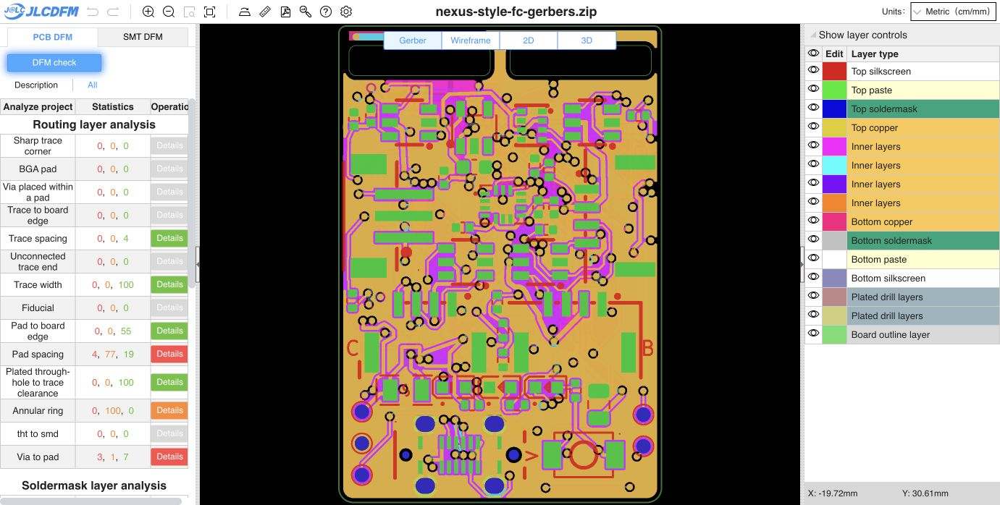

# Final outer-layer 0.14 mm routing

All outer-layer tracks are now at least 0.14 mm. The remaining 67 narrow segments in the incoming saved PCB were widened with small local routing adjustments. 114 existing segments changed and 90 segments were added to form the local detours. One IMU_CS via moved from (113.300, 110.830) to (113.316, 110.830) mm, with its attached traces following it. Its dimensions, drill and net are unchanged. One attached inner-layer trace endpoint follows the shifted via; its width is unchanged. This opens the IMU_INT passage between IMU_CS and SPI1_MOSI without reducing clearance.

The incoming saved PCB was `1c2e87c6fea4996e27367d64739357e311b381508ba9d60fca55c1fbb0d2ea6d`. It retained the owner's new three-segment SPI1_SCK route but lacked the previous partial-width profiles. Those three owner-added segments are preserved exactly in this final board. Historical website counts apply to their original sealed inputs.

Native KiCad DRC with matching project/rule files and refilled zones: **zero copper violations, zero unconnected items**. All 10 schematic parity warnings exactly match the incoming baseline. The trial that widened traces without rerouting had 65 clearance violations and was rejected. The minimum clearance remains 0.127 mm; no rules or exclusions were relaxed.

Footprints, pads, placement, net assignments, inner-layer widths, all other vias, stack, outline, keepouts, zone definitions, schematic and project are unchanged. See [geometry verification](geometry-verification.json), [complete route diff](source-route-diff.json), [baseline DRC](baseline-drc.json) and [final DRC](drc.json). The source-route diff captures final coordinates including the IMU_INT adjustment and via-attached trace changes.

- Final PCB SHA-256: `1d7d22a14a0940b6d75dfd2947ed16a6a38db063f3496ff68edf55b36f60e853`
- Gerber ZIP SHA-256: `764ea0bf47a11f5b04605485829e93a6b80c13eafd0eb823cd4e40e0945ca719`
- [Exact input binding](input-binding.json); regenerated 16-member Gerber/drill/job ZIP
- BOM (51 groups) and CPL (83 placements) reproduce byte-for-byte; SMT was not rerun for this copper revision. Child board and CAM are unchanged.

Fresh [JLCDFM PCB analysis](https://jlcdfm.com/viewer?pcbUploadFileId=634263407844352001) completed: **Trace width 0 danger, 0 warning, 100 Good**. Sharp corners retain zero danger/warning; trace spacing retains zero danger/warning and four Good results. All other category counts match the preceding website check. [Full category capture](pcb-summary.json) and [comparison](dfm-comparison.json) are retained. Width tables are capped by the website; independently, the full native inventory verifies no outer trace below 0.14 mm.

Release remains **HOLD** for other PCB, prior assembly/model and engineering qualification gates. Reload the saved PCB in an already-open KiCad editor before saving, to retain these file changes.
