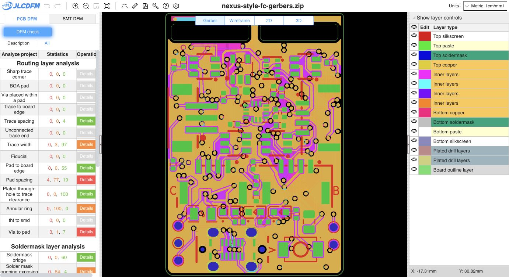

# Partial-segment 0.14 mm width improvement

The earlier width pass rejected an entire segment when any part of it failed clearance. This pass splits those segments along their existing straight routes and widens the clearance-safe sections to 0.14 mm, retaining short 0.127 mm necks at obstructions. No clearance rules or exclusions were relaxed.

**57.832 mm across 25 nets** was widened. 56 original segments were improved and merged into 131 sections with adjacent equal widths combined. Of the incoming 78.471 mm at 0.127 mm on the outer layers, 20.639 mm remains narrow, a 73.7% reduction in narrow length. Thirteen original segments remain completely narrow. This is a conservative clearance-safe pass; it does not establish that further improvement is impossible.

A trial widening all 69 remaining narrow outer segments produced 68 clearance violations. Testing 539 shorter fragments identified the local obstructions; widening only the safe fragments and merging equal-width neighbours produced zero copper violations and zero unconnected items. The native final report retains exactly the incoming 10 schematic parity warnings (nine symbol mismatches and one footprint-filter mismatch).

Pad/footprint geometry and placement, vias, arcs, all other tracks, net assignments, outline, layers, stack, custom rules, keepouts, zone definitions, project and schematic are unchanged. New section endpoints stay on the original straight centerlines within 0.707 nm integer-coordinate rounding. Original route endpoints and continuity are preserved. Zones were refilled with the matching native project/rules. No raw Python zone-filler or legacy generator was used.

- Main PCB SHA-256: `f829dfd68c797b83f90d01b5b13512ba0160a10fa3feb0317f43d6c79c15921f`
- Gerber ZIP SHA-256: `7ed20a788d0e9f72faebd0c28ff9b3f649908b1d42f252649c962a91c1f29d82`
- [Exact input binding](input-binding.json), [width section receipts](width-profiles.json), [geometry verification](geometry-verification.json) and [native DRC](drc.json)
- 16 Gerber/drill/job members regenerated; BOM (51 groups) and CPL (83 placements) reproduce byte-for-byte. Child source and CAM remain unchanged. SMT analysis was not repeated.

| Net | Improved original segments | Length widened to 0.14 mm |
| --- | ---: | ---: |
| 3V3_SENS | 1 | 1.634 mm |
| 5V | 1 | 0.366 mm |
| A_RX | 5 | 3.641 mm |
| A_TX | 3 | 7.044 mm |
| B_RX | 3 | 2.150 mm |
| CC2 | 2 | 1.121 mm |
| C_RX | 1 | 0.370 mm |
| DSM_DATA | 3 | 1.657 mm |
| DSM_TX | 1 | 1.760 mm |
| GND | 11 | 12.191 mm |
| I2C1_SCL | 2 | 1.782 mm |
| I2C1_SDA | 1 | 1.963 mm |
| IMU_CS | 4 | 3.578 mm |
| IMU_INT | 1 | 0.133 mm |
| LED3_A | 2 | 0.701 mm |
| OSC_IN | 1 | 1.405 mm |
| OSC_OUT | 1 | 1.316 mm |
| PR1 | 1 | 0.261 mm |
| S1 | 2 | 1.605 mm |
| S3 | 1 | 1.163 mm |
| SPI1_MOSI | 2 | 2.952 mm |
| SPI1_SCK | 2 | 1.685 mm |
| SPI2_MISO | 2 | 3.923 mm |
| SPI2_MOSI | 1 | 1.622 mm |
| TAIL | 2 | 1.809 mm |

Fresh [JLCDFM PCB analysis](https://jlcdfm.com/viewer?pcbUploadFileId=634259560843612162) completed on the regenerated ZIP. Displayed trace-width warnings decreased **25 → 3**, with Good results increasing **75 → 97**. Sharp corners and trace spacing retain zero danger/warning results. All other 28 category counts match the incoming-board check. See [category capture](pcb-summary.json) and [comparison](dfm-comparison.json).

The website caps width results at 50 per layer. These displayed counts are not an exhaustive count of all remaining narrow native sections; the native width receipts and length totals above record the full change. Short constrained necks remain intentionally narrow.

Release status remains **HOLD**. Prior assembly/model findings and engineering qualification gates remain open. Historical reports retain their original bindings.
